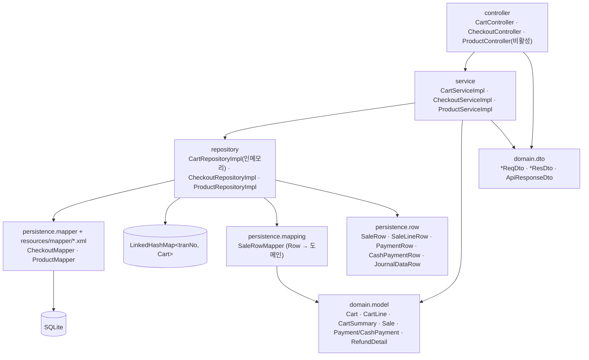
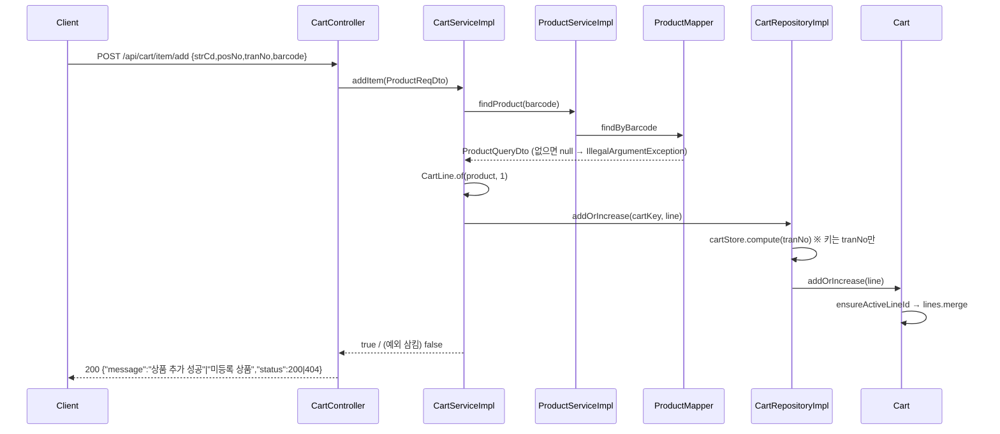
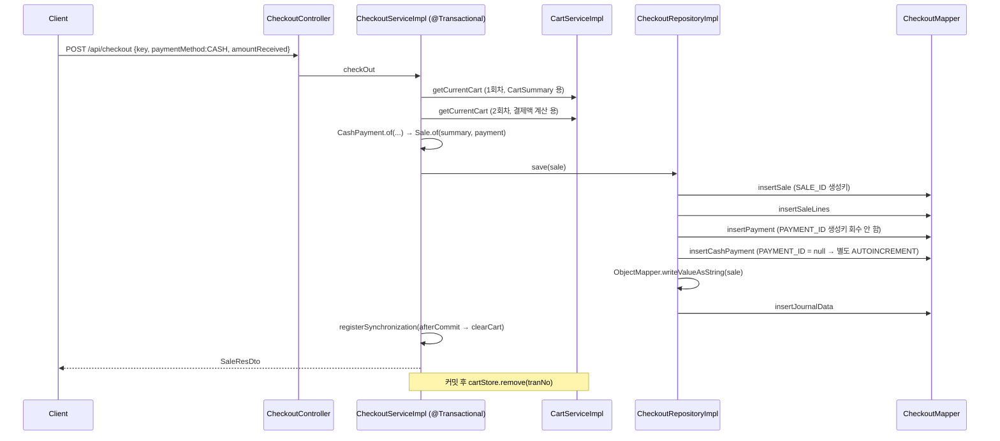
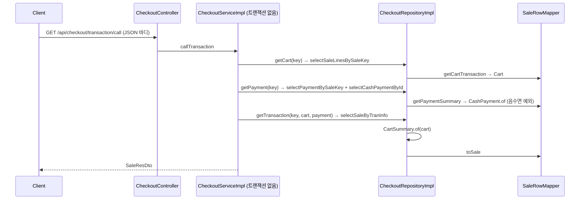
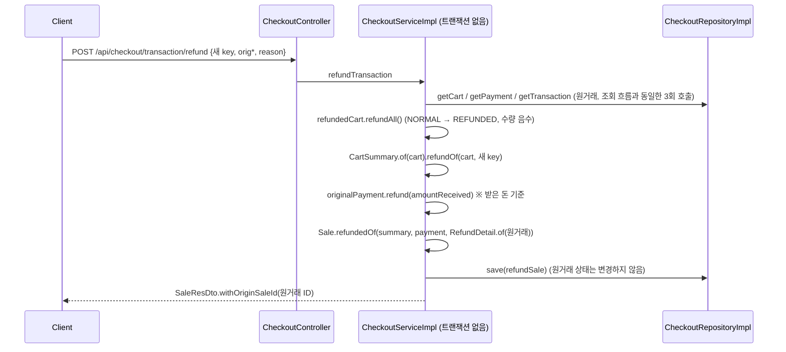

# 아키텍처 분석 및 리팩토링 계획

> 기준 커밋: `d2a038f` · 작성 시점의 코드만 분석했고 코드는 수정하지 않았다.
> 라인 번호는 `src/main/java/com/toyproject/pos/` 기준 상대 경로다.
> 현재 동작은 `src/test/java/com/toyproject/pos/integration/` 통합 테스트 24개로 고정되어 있다.

## 1. 현재 아키텍처

### 1.1 계층과 패키지 책임

| 패키지 | 의도한 책임 | 실제로 하는 일 |
|---|---|---|
| `controller` | HTTP 매핑, 요청/응답 변환 | 응답 메시지·상태 결정, 일괄 등록 루프 실행 (비즈니스 로직이 섞여 있음) |
| `service` | 유스케이스 조율, 트랜잭션 | 도메인 생성, 결제 수단 분기, 반품 조립, 커밋 후 카트 정리 |
| `repository` | 저장소 추상화 | 인메모리 카트 저장 + **카트 상태 판정**, 결제 저장 순서 결정, **Sale 조립**, TR JSON 직렬화 |
| `persistence.mapper` | SQL 실행 | MyBatis 인터페이스 + XML |
| `persistence.row` | 테이블 1:1 Row | Row 생성 시 **거스름돈 재계산** 같은 도메인 계산 포함 |
| `persistence.mapping` | Row → 도메인 | `CommonPaymentData`·`CartLine`을 직접 빌드 |
| `domain.model` | 불변 도메인 + 규칙 | 대체로 맞음. 영수증 번호·시각 생성까지 담당 |
| `domain.dto` | API 계약 | 응답 DTO가 **거스름돈을 재계산**(`CashPayloadDto`) |

### 1.2 장바구니 담기

### 1.3 현금 결제

### 1.4 거래 조회

### 1.5 반품

## 2. 문제점 (파일:라인 근거)

### 2.1 중복 코드
| ID | 내용 | 근거 |
|---|---|---|
| D1 | 요청 DTO에서 거래 키 꺼내기 반복 | `service/implement/CartServiceImpl.java:47`, `:69`, `:79` (`productReqDto.getCartInfoReqDto().getKey()`) |
| D2 | 거스름돈 계산이 3곳에 있음 | `domain/model/payment/CashPayment.java:50`, `persistence/row/CashPaymentRow.java:30`, `domain/dto/payment/CashPayloadDto.java:21` |
| D3 | 날짜 포맷 함수 중복, 타임존도 서로 다름 | `domain/model/sale/Sale.java:72-74`(systemDefault), `domain/model/sale/RefundDetail.java:29-31`(systemDefault), `domain/model/payment/CommonPaymentData.java:40-43`(Asia/Seoul) |
| D4 | 결제 수단 분기가 4곳, 그중 2곳은 문자열 비교 | `service/implement/CheckoutServiceImpl.java:116`, `repository/implement/CheckoutRepositoryImpl.java:44`(`name()` 문자열), `persistence/mapping/SaleRowMapper.java:53`, `persistence/row/CashPaymentRow.java:28`(`name().equals("CASH")`) |
| D5 | 원거래를 불러오는 3단계 호출이 조회·반품에 중복 | `service/implement/CheckoutServiceImpl.java:64-67`, `:76-80` |
| D6 | 결제 시 같은 카트를 두 번 조회 | `service/implement/CheckoutServiceImpl.java:35`(getSaleSummary), `:136-140`(getAmountDueToPay) |
| D7 | `Sale.of`·`Sale.refundedOf` 빌더가 상태·refundDetail 빼고 동일 | `domain/model/sale/Sale.java:30-58` |
| D8 | `CartSummary.of`·`refundOf` 빌더 중복, `refundOf`는 `this`를 안 씀 | `domain/model/cart/CartSummary.java` (`of`, `refundOf`), 호출부 `service/implement/CheckoutServiceImpl.java:101-104`(버려지는 summary 생성) |
| D9 | `CommonPaymentData` 생성이 두 군데 | `domain/model/payment/CommonPaymentData.java:27-38`, `persistence/mapping/SaleRowMapper.java:68-78` |
| D10 | 응답 메시지·상태 3항 연산 중복 | `controller/CartController.java:37-38`, `:55-56` |

### 2.2 책임 위치가 잘못된 로직
| ID | 내용 | 근거 |
|---|---|---|
| L1 | Controller가 일괄 등록 루프와 성공 판정을 수행 | `controller/CartController.java:49-52` |
| L2 | Controller에 미완성 검증 TODO (아무 일도 안 함) | `controller/CartController.java:65-68` |
| L3 | Repository가 카트 상태 판정(`isCanceledItem`) — 항상 false라 사실상 죽은 코드. 같은 판정을 `Cart.updatedItemQty`가 이미 함 | `repository/implement/CartRepositoryImpl.java:57-76`, 호출 `service/implement/CartServiceImpl.java:71`, 실제 판정 `domain/model/cart/Cart.java` `updatedItemQty` |
| L4 | Repository가 도메인 조립(`CartSummary.of`) | `repository/implement/CheckoutRepositoryImpl.java:65-70` |
| L5 | Repository가 결제 수단별 저장 정책과 미지원 예외 결정 | `repository/implement/CheckoutRepositoryImpl.java:44-56` |
| L6 | Row가 도메인 계산(거스름돈) 수행 | `persistence/row/CashPaymentRow.java:27-31` |
| L7 | 응답 DTO가 도메인 값을 재계산하고, 현금이 아니어도 cash 블록 생성 | `domain/dto/payment/CashPayloadDto.java:21`, `domain/dto/payment/PaymentResDto.java:29` |
| L8 | Row에 의미 없는 하드코딩 (`origSaleId = 1`) | `persistence/row/JournalDataRow.java:37-38` |
| L9 | 도메인에 운영 값 하드코딩 (계산원 '테스터', 반품 사유 '개인사유') | `domain/model/sale/Sale.java:36`, `:56`, `domain/model/sale/RefundDetail.java:25` |
| L10 | 서비스가 예외를 삼키고 false 반환 (DB 장애도 "미등록 상품"이 됨) | `service/implement/CartServiceImpl.java:56-60` |

### 2.3 트랜잭션 경계
| ID | 내용 | 근거 |
|---|---|---|
| T1 | 반품이 여러 테이블에 쓰는데 `@Transactional` 없음 → 부분 저장 가능 | `service/implement/CheckoutServiceImpl.java:73-99` |
| T2 | 조회에 트랜잭션 없음 → 3개 쿼리가 서로 다른 시점을 볼 수 있음 | `service/implement/CheckoutServiceImpl.java:62-70` |
| T3 | 인메모리 카트 정리는 afterCommit 익명 클래스로만 처리, 반품 흐름에는 해당 없음 | `service/implement/CheckoutServiceImpl.java:50-55` |
| T4 | 카트 저장소는 트랜잭션 밖 인메모리 → 롤백 시 카트는 그대로(현재는 의도와 일치) | `repository/implement/CartRepositoryImpl.java:19` |

### 2.4 도메인 / DTO / Row 변환 중복
| 대상 | 도메인 → Row | Row → 도메인 | 도메인 → DTO |
|---|---|---|---|
| 판매 라인 | `persistence/row/SaleLineRow.java` `of` | `persistence/mapping/SaleRowMapper.java` `getCartLine` | `domain/dto/cart/CartLineDto.java:23` |
| 결제 공통 | `persistence/row/PaymentRow.java` `of` | `SaleRowMapper.java:68` `getCommonPaymentData` | `domain/dto/payment/PaymentResDto.java:23` |
| 현금 | `CashPaymentRow.java` `of`(거스름돈 재계산) | `SaleRowMapper.java:53-58` (`CashPayment.of` 재사용 → 음수면 예외) | `CashPayloadDto.java:18`(거스름돈 재계산) |
| 판매 | `persistence/row/SaleRow.java` `of` | `SaleRowMapper.java` `toSale` | `domain/dto/sale/SaleResDto.java` `of` |

핵심 문제: **Row → 도메인 복원에 생성용 팩토리(`CashPayment.of`)를 재사용해서** 생성 시 검증이 복원에도 걸린다 (반품 거래를 조회할 수 없는 원인).

### 2.5 죽은 코드
| 내용 | 근거 |
|---|---|
| 빈 설정 클래스 | `config/MyBatisConfig.java` (`@MapperScan`은 `PosProjectApplication`에 있음) |
| 사용하지 않는 DTO | `domain/dto/product/request/UpdateQtyRequest.java`, `domain/dto/sale/RefundResDto.java` |
| 사용하지 않는 import | `controller/CheckoutController.java:4` (`CardReqDto`), `controller/CartController.java` (`Cart`, `CartKey`) |
| 주석 처리된 코드 | `controller/ProductController.java:17-20`, `service/implement/CartServiceImpl.java:50-52`, `repository/interfaces/CheckoutRepository.java:12` |

## 3. 분류

### 3.1 리팩토링 (동작 변경 없음 — 현재 테스트로 보호됨)
R1 ~ R12 (아래 4장)

### 3.2 버그 수정 (동작이 바뀜 — 해당 `[현재 동작/버그]` 테스트의 기대값을 바꿔야 함)
| ID | 내용 | 근거 | 깨질 테스트 |
|---|---|---|---|
| B1 | 카트 키가 `tranNo`만 사용 → POS·점포 간 섞임 | `CartRepositoryImpl.java:25`, `:34`, `:64` | `CartIntegrationTest.sameTranNo_differentPos_sharesCart`, `sameTranNo_differentStore_sharesCart` |
| B2 | 반품 시 받은 돈 전체 환불, 거스름돈 음수 이중 계산 | `CheckoutServiceImpl.java:142-144`, `CashPayment.java:57-63`, `CashPaymentRow.java:30` | `CheckoutScenarioIntegrationTest.fullScenario` |
| B3 | 받은 금액 부족해도 승인 | `CashPayment.java:44-50` | `CheckoutEdgeIntegrationTest.insufficientCash_isApproved` |
| B4 | 원거래 상태 미갱신 → 중복 반품 가능 | `CheckoutServiceImpl.java:73-99` | `refundTwice_isAllowed`, `fullScenario`(원거래 NORMAL 검증) |
| B5 | 빈 카트 결제 허용 | `CheckoutServiceImpl.java:42-60` | `emptyCart_isCheckedOut` |
| B6 | 반품 트랜잭션 없음 (T1) | `CheckoutServiceImpl.java:73` | `refund_isNotAtomic`(@Disabled) |
| B7 | `CASH_PAYMENTS.PAYMENT_ID`를 PAYMENTS 생성키로 넣지 않음 | `persistence/row/PaymentRow.java`(`paymentId(null)`), `CashPaymentRow.java:21`, `resources/mapper/CheckoutMapper.xml` `insertPayment`(useGeneratedKeys 없음) | `cashPaymentId_isIndependentSequence` |
| B8 | 반품 거래 조회 불가 (복원에 생성 팩토리 사용) | `SaleRowMapper.java:53-58` | `callRefundTransaction_throws` |
| B9 | 없는 거래·카드 결제에서 NPE | `CheckoutRepositoryImpl.java:84-92`, `CheckoutServiceImpl.java:114-129` | `callUnknownTransaction_throwsNpe`, `cardPayment_throwsNpe` |
| B10 | 예외를 삼켜 DB 오류도 "미등록 상품" (L10) | `CartServiceImpl.java:56-60` | (없음 — 테스트 추가 필요) |
| B11 | 결제 끝난 tranNo에 다시 담기 가능 → UNIQUE 위반 | `CartRepositoryImpl.java:23-41` | `reuseTranNoAfterCheckout_violatesUnique` |
| B12 | 성인 인증·판매 상태·재고 검사 없음, 재고 차감 없음 | `CartServiceImpl.java:38-61`, `resources/mapper/ProductMapper.xml` `findByBarcode` | `adultOnlyProduct_isAddedWithoutCheck`, `discontinuedProduct_isSellable`, `checkout_doesNotDecreaseStock` |
| B13 | `qty` 누락 시 NPE (`@Builder.Default`가 역직렬화에 안 먹음) | `domain/dto/product/request/ProductReqDto.java`, `CartServiceImpl.java:67` | `updateQty_withoutQtyField_throwsNpe` |
| B14 | 반품 사유 무시, 계산원 하드코딩 (L9) | `RefundDetail.java:25`, `Sale.java:36,56` | `refundReason_isIgnored`, `fullScenario`(CASHIER) |
| B15 | 타임존 불일치 (영수증 날짜 systemDefault vs 결제 시각 Asia/Seoul) | D3 근거 | (없음 — 서버 TZ가 KST면 드러나지 않음) |
| B16 | TR_JSON의 `saleId`가 null (저장 전 직렬화) | `CheckoutRepositoryImpl.java:47-48`, `:113-124` | `fullScenario`(trJson saleId null 검증) |
| B17 | enum ↔ DB CHECK 불일치 | `docs/schema-issues.md` 7번 | (없음) |

### 3.3 API 변경 (요청/응답 계약이 바뀜)
| ID | 내용 | 근거 | 깨질 테스트 |
|---|---|---|---|
| A1 | GET + RequestBody → 쿼리 파라미터/경로 변수 | `controller/CartController.java:25-26`, `controller/CheckoutController.java:22-31` | `PosApiTestSupport`의 `getCart`, `callTransaction` 및 이를 쓰는 대부분 |
| A2 | 요약 API 경로 변수가 무시됨 → 경로 변수 사용 | `controller/CheckoutController.java:22-24` | `summary_ignoresPathVariables` |
| A3 | 응답 형식 통일 (`ApiResponseDto` / `boolean` / 도메인 객체 혼재) | `CartController.java:26,33,64,76`, `CheckoutController.java:23` | 카트 관련 테스트 전반 |
| A4 | 실패를 HTTP 상태로 표현 (미등록 404, 검증 실패 400, 전역 `@RestControllerAdvice`) | `CartController.java:36-39`, 예외 처리기 없음 | `unknownBarcode_returns200WithBody404`, 예외를 기대하는 테스트 전부 |
| A5 | 카트 응답을 전용 DTO로 (내부 필드 `barcodeToLineMap`, `seq` 노출 제거) | `CartController.java:26` (도메인 `Cart` 직접 반환) | `getCart_exposesInternals`, `fullScenario`(`linesList` 키) |
| A6 | 요청 검증 추가 (`@Valid`, `qty >= 1` — 미사용 `UpdateQtyRequest` 활용 가능) | `CartController.java:64-71`, `UpdateQtyRequest.java` | `updateQty_rejectedCases`, `updateQty_withoutQtyField_throwsNpe` |
| A7 | 현금이 아닐 때 `payment.cash`를 null로 | `PaymentResDto.java:29` | (현재 현금만 있어 없음) |

## 4. 리팩토링 항목

각 항목은 **동작을 바꾸지 않는다.** 항목마다 `./gradlew test` 전체 통과를 확인하고 커밋한다.

| ID | 변경 내용 | 영향 파일 | 위험도 | 보호 테스트 | 예상 커밋 메시지 |
|---|---|---|---|---|---|
| R1 | 죽은 코드 제거: 빈 `MyBatisConfig`, 미사용 `RefundResDto`·`UpdateQtyRequest`(A6에서 쓸 예정이면 유지), 미사용 import, 주석 코드 | `config/MyBatisConfig.java`, `domain/dto/sale/RefundResDto.java`, `controller/*.java`, `repository/interfaces/CheckoutRepository.java` | 하 | 전체 (컴파일 + `contextLoads`) | `refactor: 미사용 클래스 및 주석 코드 제거` |
| R2 | `ProductReqDto`·`PaymentReqDto`에 `getKey()` 위임 메서드 추가, 서비스 호출부 단순화 (D1) | `ProductReqDto.java`, `PaymentReqDto.java`, `CartServiceImpl.java`, `CheckoutServiceImpl.java`, `CommonPaymentData.java` | 하 | `CartIntegrationTest` 전체, `fullScenario` | `refactor(cart): 요청 DTO 거래 키 추출 메서드 추가` |
| R3 | 결제 수단 문자열 비교를 enum 비교로 (D4 중 문자열 2곳) | `CheckoutRepositoryImpl.java:44-56`, `CashPaymentRow.java:28` | 하 | `fullScenario`, `insufficientCash_isApproved`, `cardPayment_throwsNpe` | `refactor(payment): 결제 수단 분기를 enum 비교로 변경` |
| R4 | 죽은 판정 `isCanceledItem` 제거 — `Cart.updatedItemQty`가 이미 같은 판정 (L3) | `CartRepository.java`, `CartRepositoryImpl.java:57-76`, `CartServiceImpl.java:71` | 하 | `updateQty_rejectedCases`, `cancel_andRescan` | `refactor(cart): 중복 취소 상태 판정 제거` |
| R5 | 결제 시 카트 1회만 조회해 summary·결제액을 함께 계산 (D6) | `CheckoutServiceImpl.java:34-38`, `:106-141` | 하 | `fullScenario`, `emptyCart_isCheckedOut`, `insufficientCash_isApproved`, `summary_ignoresPathVariables` | `refactor(checkout): 결제 시 장바구니 중복 조회 제거` |
| R6 | 거스름돈 계산을 한 곳(`CashPayment` 정적 메서드 등)으로 모으고 Row·DTO는 그것을 호출. **공식(받은 돈 − 결제액)은 그대로 유지** — 저장된 `change` 필드를 쓰면 반품 값이 바뀌므로(B2) 금지 (D2, L6, L7) | `CashPayment.java`, `CashPaymentRow.java`, `CashPayloadDto.java` | 중 | `fullScenario`(반품 −30500 포함), `insufficientCash_isApproved` | `refactor(payment): 거스름돈 계산 로직 단일화` |
| R7 | 날짜 포맷을 공용 유틸로 통합하되 **각 호출부의 타임존은 그대로 유지** (D3). 타임존 통일은 B15로 분리 | `Sale.java`, `RefundDetail.java`, `CommonPaymentData.java`, 신규 유틸 1개 | 하 | `fullScenario`(receiptNo 정규식, approvedAt) | `refactor: 날짜 포맷 유틸 통합` |
| R8 | `CommonPaymentData` 복원용 팩토리 추가, `SaleRowMapper`에서 사용 (D9) | `CommonPaymentData.java`, `SaleRowMapper.java:68-78` | 하 | `fullScenario`(조회 단계), `cashPaymentId_isIndependentSequence` | `refactor(payment): 결제 공통 정보 생성 팩토리 통합` |
| R9 | `Sale.of`/`refundedOf`, `CartSummary.of`/`refundOf` 빌더 중복 정리, 버려지는 summary 생성 제거 (D7, D8) | `Sale.java`, `CartSummary.java`, `CheckoutServiceImpl.java:101-105` | 하 | `fullScenario`(반품 단계), `refundTwice_isAllowed`, `refundReason_isIgnored` | `refactor(sale): 판매·요약 생성 팩토리 중복 정리` |
| R10 | 원거래 불러오기 3단계를 서비스 private 메서드 하나로 (D5) | `CheckoutServiceImpl.java:62-81` | 하 | `fullScenario`, `callRefundTransaction_throws`, `callUnknownTransaction_throwsNpe`, `refundTwice_isAllowed` | `refactor(checkout): 거래 복원 로직 중복 제거` |
| R11 | 일괄 등록 루프와 성공 판정을 서비스로 이동, 응답 메시지 생성 헬퍼로 묶기. 응답 바디·상태는 그대로 (L1, D10) | `CartController.java:32-59`, `CartService.java`, `CartServiceImpl.java` | 중 | `addMany_withUnknown_isPartiallyApplied`, `unknownBarcode_returns200WithBody404` | `refactor(cart): 상품 일괄 등록 로직을 서비스로 이동` |
| R12 | Repository의 `CartSummary.of` 조립을 서비스로 이동 — `getTransaction`은 SaleRow 조회만 (L4) | `CheckoutRepository.java`, `CheckoutRepositoryImpl.java:65-70`, `CheckoutServiceImpl.java` | 중 | `fullScenario`(조회·반품), `refundTwice_isAllowed` | `refactor(checkout): 판매 조립 책임을 서비스로 이동` |

**리팩토링으로 분류하지 않은 것**
- `@Transactional(readOnly = true)` 추가(T2): sqlite-jdbc는 연결 후 read-only 플래그 변경을 거부하는 경우가 있어 동작이 바뀔 수 있다. 실험 후 결정한다 → B6와 함께 트랜잭션 정리 작업에서 다룬다.
- 결제 수단별 저장 정책을 Repository에서 빼는 것(L5): 카드 결제 구현(B9) 때 설계와 함께 바꾸는 편이 낫다.
- afterCommit 익명 클래스 정리(T3): 효과가 작고 B1(카트 키 변경) 때 함께 손보는 편이 낫다.

## 5. 추천 실행 순서

위험이 낮고 이후 작업을 쉽게 만드는 것부터 진행한다.

| 순서 | 항목 | 이유 |
|---|---|---|
| 1 | R1 죽은 코드 제거 | 위험 거의 없음, 이후 diff가 깨끗해짐 |
| 2 | R2 거래 키 추출 | 단순, 서비스 코드 가독성 개선 |
| 3 | R3 enum 비교 | 단순, 이후 결제 수단 작업의 기반 |
| 4 | R4 죽은 판정 제거 | 단순, 카트 규칙이 `Cart` 한 곳에 모임 |
| 5 | R7 날짜 유틸 | 단순, B15 수정 지점을 하나로 만듦 |
| 6 | R6 거스름돈 단일화 | 효과 큼 — B2·B3 수정 지점을 하나로 만듦 |
| 7 | R8 결제 공통 정보 팩토리 | B8(반품 조회) 수정의 사전 작업 |
| 8 | R5 카트 중복 조회 제거 | 결제 흐름 단순화, B5(빈 카트) 수정 지점 확보 |
| 9 | R9 팩토리 중복 정리 | 반품 흐름 단순화 |
| 10 | R10 거래 복원 중복 제거 | 조회·반품 공통화, B4·B9 수정 지점 확보 |
| 11 | R12 판매 조립 서비스 이동 | 계층 책임 정리 (R10 이후가 자연스러움) |
| 12 | R11 일괄 등록 서비스 이동 | 컨트롤러 정리, A3·A4 사전 작업 |

리팩토링이 끝난 뒤 권장 순서:
1. **버그 수정**: B7(결제 ID) → B6(반품 트랜잭션) → B2·B3(금액) → B4(중복 반품) → B8·B9(조회/NPE) → B1(카트 키) → 나머지. 각 수정마다 해당 `[현재 동작/버그]` 테스트의 기대값을 새 동작으로 바꾸는 것을 같은 커밋에 포함한다 (커밋 타입 `fix`).
2. **API 변경**: A4(예외→HTTP 상태) → A6(요청 검증) → A5(카트 응답 DTO) → A3(응답 형식) → A1·A2(GET 바디 제거). API 변경은 버그 수정·리팩토링과 섞지 않는다 (CLAUDE.md 커밋 규칙).
