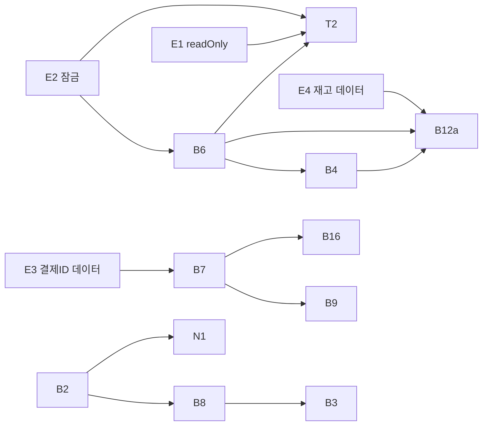

# 버그 수정 계획

> 기준 커밋: `f858f26` (리팩토링 1~14 완료 시점). 이 문서를 쓰는 동안 코드는 수정하지 않았다.
> 버그 ID(B1~B17)와 테스트 이름은 `docs/architecture.md` 3.2절과 `src/test/java/com/toyproject/pos/integration/` 기준이다.
> 라인 번호는 `src/main/java/com/toyproject/pos/` 기준 상대 경로이고, 모두 `f858f26` 시점이다.
> 현재 테스트: 27개 (통과 26, `@Disabled` 1 = `refund_isNotAtomic`).

## 0. 요약

| 등급 | 의미 | 항목 |
|---|---|---|
| **P0** | 거래 흐름(담기 → 현금 결제 → 조회 → 반품)과 재고 차감에 직접 영향 | B7, B6, B2(+N1), B8, B3, B5, B4, B9, B1(+T3), N5(장바구니 동시성), B12a(재고 차감) |
| **P1** | 데이터 정합성 (흐름은 돌지만 저장된 값이 틀림) | B16, B12b(판매중지 차단), B10 |
| **P2** | 나중에 해도 됨 (작고 독립적) | B14a(반품 사유), B15(타임존) |
| **보류** | 지금 고치지 않음 (이유는 1장에) | B11, B13, B12c(성인 인증), B12d(재고 부족 차단), B14b(계산원), B17 |

B12와 B14는 성격이 다른 문제가 섞여 있어 나눴다 (B12a~d, B14a~b).
**목록 밖에서 새로 찾은 문제** N1~N4는 1.4절, N5(Q6 결정으로 생긴 동시성 문제)는 5.1절에 있다. N1은 B2와 같은 배치에서 처리한다.

---

## 1. 분류

### 1.1 P0 — 거래 흐름·재고 차감

| ID | 한 줄 요약 | 왜 P0인가 |
|---|---|---|
| B7 | `CASH_PAYMENTS.PAYMENT_ID`가 PAYMENTS 생성키와 무관한 별도 AUTOINCREMENT | 시퀀스가 어긋나면 현금 상세가 **다른 결제에 붙고**, 조회 단계에서 NPE. 카드 결제 등 현금 상세가 없는 결제가 1건만 생겨도 이후 모든 조회가 깨짐 |
| B6 | 반품(`refundTransaction`)에 `@Transactional` 없음 | 반품은 SALES·SALE_LINES·PAYMENTS·CASH_PAYMENTS·RECEIPT_JOURNAL 다섯 테이블에 쓴다. 중간에 실패하면 반품이 일부만 저장됨. B4·B12a(반품 재입고)의 전제 조건 |
| B2 | 반품 시 결제액이 아니라 받은 돈 전체를 환불, 거스름돈 음수 이중 계산 | 반품 금액이 틀림 (10500원 거래를 20000원 환불, 거스름돈 −30500) |
| B8 | 반품 거래를 조회할 수 없음 | 반품 후 조회가 항상 500 |
| B3 | 받은 금액이 부족해도 승인 | 1500원 상품을 1000원 받고 승인, 거스름돈 −500 저장 |
| B5 | 빈 카트 결제 허용 | 0원 거래가 SALES에 저장되고 tranNo가 소비됨 |
| B4 | 원거래 상태가 바뀌지 않아 중복 반품 가능 | 같은 거래를 무한히 반품할 수 있음 (금전 손실) |
| B9 | 없는 거래 조회·카드 결제가 NPE | 원인을 알 수 없는 500. 수정은 명확한 예외로 바꾸는 것까지 (카드 결제 구현은 범위 밖) |
| B1 | 카트 키가 `tranNo`만 사용 | 다른 POS·점포가 같은 tranNo를 쓰면 장바구니가 섞이고, 결제가 엉뚱한 POS 번호로 저장됨 |
| B12a | 결제해도 재고가 줄지 않음 | 사용자가 P0로 지정. 반품 시 재입고 포함 |

### 1.2 P1 — 데이터 정합성

| ID | 한 줄 요약 | 왜 P0가 아닌가 |
|---|---|---|
| B16 | `RECEIPT_JOURNAL.TR_JSON`의 `saleId`가 null | 흐름은 정상. 전자저널 원문의 식별자가 비어 있음 (SALE_ID 컬럼으로는 연결됨) |
| B12b | 판매중지(`discontinued`) 상품이 담기고 결제됨 | 판매 정책 위반이지만 금액·키는 정상 |
| B10 | 예외를 삼켜서 DB 오류도 "미등록 상품"으로 응답 | 장애가 숨겨짐. 데이터는 변하지 않음 |

### 1.3 P2 / 보류

| ID | 등급 | 이유 |
|---|---|---|
| B14a 반품 사유 무시 | P2 | 요청에 이미 `reason`이 있어서 한 줄로 고칠 수 있음. TR_JSON에만 남는 값이라 영향이 작음 |
| B15 타임존 불일치 | P2 | 서버 TZ가 KST면 드러나지 않음. 서버를 UTC 환경(클라우드 등)에 배포하기 전에는 고칠 것 |
| B11 결제 끝난 tranNo에 다시 담기 | **보류** | 중복 저장은 DB UNIQUE 제약이 이미 막고 있어 데이터는 안전함. 남는 문제는 에러 메시지와 HTTP 상태뿐인데, 이는 **A4(예외 → HTTP 상태)** 에서 다뤄야 제대로 고쳐짐. `addItem`이 `boolean`을 돌려주는 지금 구조로는 "이미 결제된 거래"를 표현할 수 없음 (`"미등록 상품"`으로 응답하게 됨) |
| B13 `qty` 누락 시 NPE | **보류 → A6** | NPE는 서비스가 아니라 **`controller/CartController.java:45`의 빈 TODO**(`productReqDto.getQty() > 1`, 언박싱)에서 난다. 사용자 지시대로 빈 TODO(L2)는 A6 때 지우므로, 지금 서비스만 고쳐서는 NPE가 그대로 남음. A6의 `@Valid @NotNull`로 400을 주는 것이 올바른 수정이고, 지금 고치면 A6에서 같은 테스트 기대값을 또 바꿔야 함 |
| B12c 성인 인증 | **보류** | 요청에 "성인 인증 완료" 같은 입력이 없음. 인증 방식(점원 확인 버튼, 신분증 스캔)을 정한 뒤 요청 필드를 추가해야 하므로 **API 변경**임 |
| B12d 재고 부족 시 판매 차단 | **보류 (정책 결정 필요)** | 편의점 POS는 보통 전산 재고가 0이어도 실물이 있으면 판매를 허용하고 음수 재고로 둔다. 차단 여부는 운영 정책이라 코드로 정할 일이 아님. 이 계획은 **차단하지 않고 음수 재고를 허용**하는 것을 전제로 한다 |
| B14b 계산원 하드코딩 | **보류** | 요청에 계산원 정보가 없음. 로그인·세션 또는 요청 필드 추가가 필요하므로 **API 변경 / 인증 설계** 영역 |
| B17 enum ↔ DB CHECK 불일치 | **보류** | 지금은 실행 경로에서 도달하지 않음. `ItemStatus.EMPTY`는 `CartLine.EMPTY` 센티널이라 `lines`에 들어가지 않고, `PaymentStatus.CREATED`는 쓰는 곳이 없음. `VOIDED`·`VOUCHER`·`POINT`는 DB에도 저장되지 않음. 고치려면 운영 스키마 변경(마이그레이션)이나 enum 정리가 필요한데, 결제 취소·카드 결제를 구현할 때 함께 정하는 편이 맞음. 원하면 보호용으로 "저장되는 enum 값 ⊆ CHECK 값" 검사 테스트만 먼저 추가할 수 있음 |

### 1.4 목록 밖에서 새로 찾은 문제

계획을 세우려고 코드를 읽다가 찾은 것들이다. 아직 어느 테스트도 이 동작을 검증하지 않는다.

| ID | 내용 | 근거 | 제안 |
|---|---|---|---|
| **N1** | 반품 결제가 원거래의 `CommonPaymentData`를 그대로 재사용함 → 반품 거래의 `PAYMENTS.APPROVED_AT`, `SALES.APPROVED_AT`, `RECEIPT_JOURNAL.APPROVED_AT`이 **원거래 승인 시각**이고, 결제 정보의 `tranNo`도 원거래 키 | `domain/model/payment/CashPayment.java:62-68` (`toBuilder`로 `commonPayment` 복사), `persistence/row/SaleRow.java`(`approvedAt(payment.approvedAt())`) | **B2와 같은 배치, 별도 `fix` 커밋**. 반품 결제를 만들 때 새 키와 현재 시각으로 `CommonPaymentData`를 새로 만듦 |
| **N2** | 반품 거래를 복원하면 `CartSummary.of(cart)`가 NORMAL 라인만 합산해서 총수량·총금액이 0, 결제 상태도 항상 `APPROVED`로 복원됨 | `service/implement/CheckoutServiceImpl.java:96`, `domain/model/cart/CartSummary.java:22-24`, `CashPayment.java:52` | B8을 고치면 바로 드러나므로 **B8 커밋에 포함** (B8의 기대 동작 자체에 해당) |
| **N3** | 반품 거래를 조회한 응답의 `origSaleId`가 null (`SALES.ORIG_SALE_ID`를 읽지만 쓰지 않음) | `persistence/mapping/SaleRowMapper.java:39`(`refundDetail(null)`) | B8 커밋에 포함하거나 P2로 분리. **B8을 진행할 때 사용자 확인** |
| **N4** | `JournalDataRow`의 `origSaleId = 1`·`origReceiptNo = ""` 하드코딩(L8)은 `RECEIPT_JOURNAL`에 해당 컬럼이 없고 INSERT에도 없어 저장되지 않음 | `persistence/row/JournalDataRow.java:37-38`, `resources/mapper/CheckoutMapper.xml:139-157` | 버그 아님. 동작이 바뀌지 않으므로 **refactor 커밋으로 제거** (버그 수정 배치와 섞지 않음) |

---

## 2. 버그별 상세

표기
- **실패 테스트**: 수정 전에 먼저 추가하거나 기대값을 바꿔서 **빨간 상태를 확인**하는 테스트
- **같이 바뀌는 기대값**: 그 수정 때문에 함께 고쳐야 하는 기존 테스트 단언. 여기에 없는 단언이 깨지면 **멈추고 보고**한다
- 위험도: 하(국소적) / 중(여러 계층에 걸침) / 상(데이터·계약에 영향)

### B7 — CASH_PAYMENTS.PAYMENT_ID 불일치 `P0`

- **재현**: 현금 결제 1건 → PAYMENTS에 현금 상세가 없는 행 1개 직접 INSERT → 두 번째 현금 결제 → 두 번째 결제의 현금 상세가 고아 PAYMENT_ID에 붙음 (`cashPaymentId_isIndependentSequence`가 이미 재현함)
- **현재 동작**: `insertPayment`에 `useGeneratedKeys`가 없고 `CashPaymentRow.paymentId(null)` → CASH_PAYMENTS가 자체 AUTOINCREMENT로 번호를 매김
- **기대 동작**: `CASH_PAYMENTS.PAYMENT_ID` = 같은 결제의 `PAYMENTS.PAYMENT_ID`
- **수정**: `CheckoutMapper.xml` `insertPayment`에 `useGeneratedKeys="true" keyProperty="paymentId" keyColumn="PAYMENT_ID"` 추가(`insertSale`과 같은 방식. `SaleRow.saleId`도 final 필드인데 생성키가 채워지고 있으니 같은 방식이 동작함) → `CashPaymentRow.of(payment, paymentId)`로 ID 전달
  - 복원 시 `CommonPaymentData.restoredOf`에 `paymentId` 인자 추가 (architecture.md 배치 2 메모). 응답·TR_JSON에 `paymentId`를 노출할지는 범위 밖 (복원 객체에만 채움)
- **실패 테스트**: `cashPaymentId_isIndependentSequence` → `cashPaymentId_matchesPaymentId`로 바꿈. 고아 결제를 만든 뒤에도 `cashPaymentId == paymentId`이고 `callTransaction`이 성공해야 함
- **같이 바뀌는 기대값**
  - 같은 테스트의 `finally` 블록: 지금은 시퀀스를 맞추려고 `CASH_PAYMENTS`에 `MAX(PAYMENT_ID)`를 INSERT 하는데, 수정 후에는 그 ID에 이미 현금 상세가 있어 **PK 충돌이 남** → 블록 삭제
  - `fullScenario`의 81~82행 주석(`[현재 동작] ... 우연히 맞아서`)만 정리. 단언 값은 그대로
- **함께 묶을 항목**: 없음. B16(TR_JSON)과 같은 배치에 두되 커밋은 분리
- **운영 데이터 주의**: 이미 어긋난 운영 CASH_PAYMENTS 행은 이 수정으로 고쳐지지 않음 → 사전 실험 E3에서 어긋난 행이 있는지 확인
- **영향 파일**: `resources/mapper/CheckoutMapper.xml`, `persistence/row/CashPaymentRow.java`, `repository/implement/CheckoutRepositoryImpl.java`, `domain/model/payment/CommonPaymentData.java`, `persistence/mapping/SaleRowMapper.java`, `CheckoutEdgeIntegrationTest.java`
- **위험도**: 중 (저장 경로 변경, 운영 데이터 확인 필요)
- **커밋**: `fix(payment): 현금 결제 상세에 결제 생성키 연결`

### B6 — 반품 트랜잭션 없음 `P0`

- **재현**: 반품 중 CASH_PAYMENTS INSERT를 실패하게 만듦 → SALES·SALE_LINES·PAYMENTS에는 반품 행이 남음
- **현재 동작**: MyBatis가 매퍼 호출마다 자동 커밋함 → 부분 저장
- **기대 동작**: 하나라도 실패하면 반품 전체가 롤백됨 (반품 SALES 행 0건)
- **실패 테스트**: `refund_isNotAtomic`(`@Disabled`) → `refund_isAtomic`으로 바꾸고 켬. **프로덕션 코드를 고치지 않고 실패를 넣는 방법: 테스트에서 SQLite 트리거 사용**
  ```sql
  CREATE TRIGGER fail_refund_cash BEFORE INSERT ON CASH_PAYMENTS
  WHEN NEW.AMOUNT_RECEIVED < 0
  BEGIN SELECT RAISE(ABORT, 'injected failure'); END;
  ```
  - 반품만 받은 금액이 음수이므로 반품 INSERT만 실패함. 테스트 `finally`에서 `DROP TRIGGER IF EXISTS fail_refund_cash`
  - 단언: 루트 원인이 `SQLiteException`(메시지 `injected failure`), `countSales(POS_1, refundTranNo) == 0`, 원거래는 변화 없음
  - 주의: B2 이후에도 반품의 받은 금액은 음수(−결제액)라 트리거 조건이 그대로 유효함
- **같이 바뀌는 기대값**: 없음
- **함께 묶을 항목**: T2(조회 트랜잭션)는 3장 실험 결과에 따라 B6 다음 별도 커밋. B4·B12a는 B6 이후에만 가능
- **영향 파일**: `service/implement/CheckoutServiceImpl.java` (`refundTransaction`에 `@Transactional`), `CheckoutScenarioIntegrationTest.java`
- **위험도**: 하 (코드는 1줄. 단, 3장 E2의 잠금 동작 확인이 필요)
- **커밋**: `fix(checkout): 반품 처리 트랜잭션 적용`

### B2 — 반품 금액 오류 `P0`

- **재현**: 10500원 거래를 20000원 받고 결제 → 반품
- **현재 동작** (`fullScenario` 130~137행)
  - 반품 `CASH_PAYMENTS.AMOUNT_RECEIVED = -20000`, `CHANGE = -30500` (= −20000 − 10500)
  - 반품 `PAYMENTS.AMOUNT_DUE_TO_PAY = 10500` (양수)
  - 도메인 `CashPayment.change`는 0이라 TR_JSON과 DB 값이 서로 다름
- **기대 동작**: **결제액만큼 환불**. 반품 SALES·SALE_LINES가 이미 음수(−10500)이므로 같은 부호를 씀
  - `AMOUNT_DUE_TO_PAY = -10500`, `AMOUNT_RECEIVED = -10500`, `CHANGE = 0`
  - 공식 `calculateChange(받은 돈, 결제액)`은 그대로 둠: (−10500) − (−10500) = 0
  - ⚠️ **결정 필요**: 반품 결제 청구액을 음수로 저장할지 (권장: SALES와 부호 일치), 양수로 두고 상태 `REFUNDED`로만 구분할지
- **수정**: `CheckoutServiceImpl.getRefund`(:136)가 받은 돈이 아니라 결제액 기준으로 환불하도록 변경. `CashPayment.refundOf`가 받은 금액·결제액을 모두 음수로, 거스름돈은 `calculateChange`로 계산
- **실패 테스트**: `fullScenario`의 반품 단언을 먼저 새 값으로 바꿔서 빨간 상태 확인
- **같이 바뀌는 기대값** (`fullScenario`)
  - 131행 `AMOUNT_DUE_TO_PAY` `10500` → `-10500` (주석 `[현재 동작] 양수 그대로` 삭제)
  - 136행 `AMOUNT_RECEIVED` `-20000` → `-10500`
  - 137행 `CHANGE` `-30500` → `0`
  - 추가: 반품 응답 `/payment/cash/change == 0`, `/payment/amountDueToPay == -10500`
- **함께 묶을 항목**: **B8**(반품 조회)과 같은 배치. B8만 먼저 고치면 조회 응답에 −30500 같은 잘못된 값이 그대로 노출됨. **N1**(반품 승인 시각·키)도 같은 메서드라 같은 배치 (커밋은 분리)
- **영향 파일**: `domain/model/payment/CashPayment.java`, `service/implement/CheckoutServiceImpl.java`, `CheckoutScenarioIntegrationTest.java`
- **위험도**: 중 (금액 계약이 바뀜. 운영에 이미 저장된 반품 행과 부호 규칙이 달라짐)
- **커밋**: `fix(payment): 반품 시 결제 금액 기준으로 환불`

### N1 — 반품 결제가 원거래 승인 시각·키를 재사용 `P0 (B2에 딸림)`

- **현재 동작**: 반품 거래의 `APPROVED_AT` 3곳(SALES·PAYMENTS·RECEIPT_JOURNAL)이 원거래 시각이고, 결제 정보의 `tranNo`가 원거래 키
- **기대 동작**: 반품 시각 = 반품 처리 시각, 결제 정보의 키 = 반품 거래 키
- **실패 테스트(신규)**: `refund_hasOwnApprovedAtAndKey` — 원거래 `PAYMENTS.APPROVED_AT`을 SQL로 과거 시각(`2000-01-01 00:00:00`)으로 바꾼 뒤 반품 → 반품 `SALES.APPROVED_AT` ≠ `2000-01-01 00:00:00`. 응답의 `approvedAt`도 같은 조건 확인
  - 테스트가 1초 경계에 의존하지 않도록 원거래 시각을 과거로 조작함
- **같이 바뀌는 기대값**: 없음 (지금 어떤 테스트도 반품 시각을 검증하지 않음)
- **영향 파일**: `CashPayment.java`, `CommonPaymentData.java`(반품용 팩토리), `CheckoutServiceImpl.java`, `CheckoutScenarioIntegrationTest.java`
- **위험도**: 하
- **커밋**: `fix(payment): 반품 결제 승인 시각과 거래 키를 반품 기준으로 생성`

### B8 — 반품 거래 조회 불가 `P0` (+N2, N3 결정)

- **재현**: 결제 → 반품 → 반품 거래 키로 `callTransaction`
- **현재 동작**: `SaleRowMapper.getPaymentSummary`(:53-58)가 생성용 `CashPayment.of`로 복원 → 받은 금액이 음수라 `IllegalArgumentException("지불 금액이 이상 합니다...")`, 500
- **기대 동작**: 반품 거래가 조회됨. 저장된 값을 그대로 복원
  - 결제: 저장된 `AMOUNT_RECEIVED`·`CHANGE`·`STATUS` 사용 (`CashPayment.restoredOf` 신설, 검증 없음)
  - 요약(N2): 저장된 `SALES.TOTAL_QTY`·`TOTAL_AMOUNT` 사용 (지금은 NORMAL 라인만 다시 합산해서 반품은 0이 됨). `CartSummary` 복원 팩토리를 추가하거나, 반품 상태면 REFUNDED 라인을 합산
  - N3(`origSaleId`): **진행 시 사용자에게 확인** (포함하면 응답 필드가 하나 채워짐)
- **실패 테스트**: `callRefundTransaction_throws` → `callRefundTransaction_returnsRefund`
  - `saleStatus = REFUNDED`, `/payment/status = REFUNDED`, `/payment/cash/amountReceived = -1500`, `/payment/cash/change = 0`, `/cart/totalQty = -1`, `/cart/totalAmount = -1500` (`paidSale(CHIPS)` 기준, B2 이후 값)
- **같이 바뀌는 기대값**: `fullScenario` 6단계(원거래 조회)는 그대로여야 함 — 정상 거래는 저장값과 다시 계산한 값이 같음. **바뀌면 멈춤**
- **함께 묶을 항목**: B2 다음 커밋 (B2 없이 하면 위 기대값의 change가 −30500이 됨)
- **영향 파일**: `persistence/mapping/SaleRowMapper.java`, `domain/model/payment/CashPayment.java`, `domain/model/cart/CartSummary.java`, `service/implement/CheckoutServiceImpl.java`(`loadTransaction`), `repository/*/CheckoutRepository*.java`(SaleRow의 합계를 넘기는 경우), `CheckoutScenarioIntegrationTest.java`
- **위험도**: 중 (복원 경로가 정상·반품 모두에 걸림)
- **커밋**: `fix(checkout): 반품 거래 조회 시 저장된 결제·합계로 복원`

### B3 — 받은 금액 부족해도 승인 `P0`

- **재현**: 1500원 상품을 1000원 받고 현금 결제
- **현재 동작**: `APPROVED`, 거스름돈 −500 저장 (`CashPayment.java:44`는 0 이하만 거절)
- **기대 동작**: `IllegalArgumentException`(500, A4 이후 400) + 저장 없음 + 장바구니 유지
- **수정**: `CashPayment.of`에서 `calculateChange(...) < 0`이면 거절. 반품은 `refundOf`를 거치고 `of`를 쓰지 않으므로 영향 없음 (B8 이후 복원도 `restoredOf`를 씀)
- **실패 테스트**: `insufficientCash_isApproved` → `insufficientCash_isRejected`: 루트 원인 `IllegalArgumentException`, `countSales == 0`, 장바구니 라인 1개 유지. 경계값 테스트 추가: 받은 금액 = 결제액(1500)이면 승인, 거스름돈 0
- **같이 바뀌는 기대값**: 없음 — 다른 결제 테스트는 모두 결제액 이상을 받음 (확인함: `paidSale` 10000/1500, `reuseTranNo` 2000/1500, `discontinued` 5000/2800, `checkout_doesNotDecreaseStock` 20000/10000, `sameTranNo_differentPos` 5000/2700, `cashPaymentId` 2000/1500, `emptyCart` 1000/0, `fullScenario` 20000/10500)
- **⚠️ B8보다 먼저 하면 안 됨**: 지금 복원도 `CashPayment.of`를 거치므로, B8 전에 B3를 하면 거스름돈이 음수로 저장된 과거 거래를 조회할 때 새로 예외가 남
- **영향 파일**: `domain/model/payment/CashPayment.java`, `CheckoutEdgeIntegrationTest.java`
- **위험도**: 하
- **커밋**: `fix(payment): 받은 금액이 결제 금액보다 적으면 결제 거절`

### B5 — 빈 카트 결제 허용 `P0`

- **재현**: 상품 없이 현금 1000원 결제
- **현재 동작**: 0원 SALES 저장
- **기대 동작**: 정상(NORMAL) 라인이 0개면 거절 (전부 취소된 카트도 포함). `IllegalStateException("결제할 상품이 없습니다")`, 저장 없음
- **수정**: `CheckoutServiceImpl.saleModelBuilder`(:106-113)에서 `cart.getTotalQtyInLines() == 0`이면 예외. 결제 객체를 만들기 전에 검사
- **실패 테스트**: `emptyCart_isCheckedOut` → `emptyCart_isRejected`. 신규 `allCancelledCart_isRejected` (담기 → 취소 → 결제)
- **같이 바뀌는 기대값**: ⚠️ **`zeroCash_throws`** — 이 테스트는 **빈 카트**에 0원을 보낸다. B5 이후에는 빈 카트 검사가 먼저 걸려 루트 원인 메시지가 바뀜 → 테스트에서 **상품을 먼저 담도록** 바꿔서 원래 의도(0원 거절)를 유지. 메시지 단언은 그대로
- **영향 파일**: `service/implement/CheckoutServiceImpl.java`, `CheckoutEdgeIntegrationTest.java`
- **위험도**: 하
- **커밋**: `fix(checkout): 빈 장바구니 결제 거절`

### B4 — 중복 반품 가능 `P0`

- **재현**: 같은 원거래를 두 번 반품
- **현재 동작**: 두 번 모두 성공, `ORIG_SALE_ID = 원거래`인 SALES 2건. 원거래는 `NORMAL` 그대로
- **기대 동작**: 첫 반품 때 원거래 `SALE_STATUS`를 `REFUNDED`로 바꾸고, 두 번째 반품은 거절 (`IllegalStateException("이미 반품된 거래입니다")`, 500 → A4 이후 409)
- **수정 방식 (권장)**: 조건부 UPDATE 한 번으로 확인과 변경을 함께 처리 — 별도 SELECT가 없어 동시 요청에도 안전
  ```sql
  UPDATE SALES SET SALE_STATUS = 'REFUNDED'
  WHERE SALE_ID = #{origSaleId} AND SALE_STATUS = 'NORMAL'
  ```
  영향받은 행이 1이 아니면 예외 → B6 트랜잭션으로 반품 INSERT 전체가 롤백됨. **스키마 변경 없음** (CHECK가 이미 `REFUNDED`를 허용)
  - 대안: `ORIG_SALE_ID` 중복 검사. 동시 요청을 막으려면 부분 UNIQUE 인덱스가 필요해 **운영 스키마를 바꿔야 하므로** 권장하지 않음
  - 부수 효과: 반품 거래(상태 REFUNDED)를 다시 반품하는 것도 막힘. 원거래를 조회하면 `saleStatus = REFUNDED`로 보임 (의도한 동작)
  - UPDATE를 반품 저장 **전에** 하면 두 번째 반품에서 INSERT를 시도하지 않음
- **실패 테스트**: `refundTwice_isAllowed` → `refundTwice_isRejected`: 두 번째 반품의 루트 원인 `IllegalStateException`, `ORIG_SALE_ID` 건수 1
- **같이 바뀌는 기대값**: `fullScenario` 142~143행 원거래 상태 `NORMAL` → `REFUNDED` (주석 삭제)
- **함께 묶을 항목**: B6 이후에만 (트랜잭션이 없으면 UPDATE 후 INSERT가 실패할 때 원거래만 REFUNDED로 남음)
- **영향 파일**: `resources/mapper/CheckoutMapper.xml`, `persistence/mapper/CheckoutMapper.java`, `repository/*/CheckoutRepository*.java`, `service/implement/CheckoutServiceImpl.java`, `CheckoutScenarioIntegrationTest.java`
- **위험도**: 중 (원거래 상태 의미가 바뀜. 운영에서 SALE_STATUS를 집계에 쓰는 곳이 있다면 확인 필요)
- **커밋**: `fix(checkout): 반품 시 원거래 상태 갱신 및 중복 반품 거절`

### B9 — 없는 거래·카드 결제 NPE `P0`

- **재현 1**: 없는 tranNo로 `callTransaction` → `CheckoutRepositoryImpl.getPayment`(:87) `paymentRow.getPaymentId()`에서 NPE
- **재현 2**: `paymentMethod = CARD`로 결제 → `getPaymentSummary`가 null 반환 → `SaleRow.of`의 `payment.approvedAt()`에서 NPE
- **기대 동작**
  - 없는 거래: 전용 예외 `TransactionNotFoundException`(신규, `RuntimeException`). A4에서 404로 매핑할 수 있게 타입을 분리함. 반품 대상 원거래가 없을 때도 같은 예외
  - 카드: `UnsupportedOperationException("CARD 결제는 아직 미지원")`을 **서비스에서** 던짐 (Sale을 만들기 전). 저장 없음, 장바구니 유지
- **수정**: `loadTransaction`이 SaleRow 존재 여부를 먼저 확인. `getPaymentSummary`의 `case CARD` → throw
- **실패 테스트**
  - `callUnknownTransaction_throwsNpe` → `callUnknownTransaction_throwsNotFound`
  - `cardPayment_throwsNpe` → `cardPayment_isUnsupported` (나머지 단언은 그대로: 저장 0건, 카트 1라인)
  - 신규 `refundUnknownTransaction_throwsNotFound`
- **같이 바뀌는 기대값**: 없음. 단, B7보다 먼저 하면 `cashPaymentId_isIndependentSequence`의 NPE 단언이 영향을 받을 수 있음 → **B7 이후에 진행**
- **함께 묶을 항목 — L5**: B9는 "실패를 명확하게"까지만 한다. 결제 수단별 저장 정책을 Repository에서 빼는 L5는 **동작이 바뀌지 않는 refactor**이고, 카드 결제를 구현할 때 설계와 함께 하는 편이 맞으므로 **이번 계획에서 제외**. B9 이후 `CheckoutRepositoryImpl.save`의 `case CARD`는 도달할 수 없게 되지만 L5 때 함께 정리
- **영향 파일**: `service/implement/CheckoutServiceImpl.java`, `repository/implement/CheckoutRepositoryImpl.java`, 신규 `common/exception/TransactionNotFoundException.java`, `CheckoutEdgeIntegrationTest.java`
- **위험도**: 하
- **커밋**: `fix(checkout): 없는 거래 조회와 카드 결제를 명시적 예외로 처리`

### B1 — 카트 키가 tranNo만 사용 `P0` (+T3)

- **재현**: POS 01과 POS 02에서 같은 tranNo로 담기 (`sameTranNo_differentPos_sharesCart`)
- **현재 동작**: 한 카트를 공유, 결제가 먼저 만든 POS 번호로 저장, 양쪽 카트가 함께 비워짐
- **기대 동작**: `(strCd, posNo, tranNo)` 단위로 카트가 분리됨
- **수정**: `cartStore`의 키를 `CartKey`로 변경. **`CartKey`에 `equals`/`hashCode`가 없음** → `@EqualsAndHashCode` 추가 또는 `record`로 변경. `clearCartStore(Sale)` → `clearCartStore(CartKey)`
  - **T3 함께 처리**: afterCommit 익명 클래스가 `cartService.clearCart(sale)`를 호출하므로 시그니처 변경에 같이 손댐. 익명 클래스를 람다 대신 쓰는 구조 정리는 **같은 커밋에 넣지 않고** 직후 `refactor` 커밋으로 분리
- **실패 테스트**
  - `sameTranNo_differentPos_sharesCart` → `sameTranNo_differentPos_isolated`: POS 02 카트에는 CHOCO만, 결제는 POS 02로 저장, POS 01 카트는 유지
  - `sameTranNo_differentStore_sharesCart` → `sameTranNo_differentStore_isolated`
- **같이 바뀌는 기대값**: 위 두 테스트 외에는 없음 (다른 테스트는 `newTranNo()`로 매번 고유한 tranNo를 씀)
- **영향 파일**: `domain/model/cart/CartKey.java`, `repository/implement/CartRepositoryImpl.java`, `repository/interfaces/CartRepository.java`, `service/*/CartService*.java`, `service/implement/CheckoutServiceImpl.java`, `CartIntegrationTest.java`
- **위험도**: 중 (인메모리 저장소 키 변경. 실행 중인 서버의 카트는 재시작으로 어차피 사라짐)
- **커밋**: `fix(cart): 장바구니 키를 점포·POS·거래번호 조합으로 변경`
- 후속(선택): `refactor(checkout): 커밋 후 장바구니 정리 콜백 단순화`

### B12a — 재고 차감 없음 `P0`

- **재현**: COOKIE(P003) 4개 결제 → INVENTORY 재고 그대로 (`checkout_doesNotDecreaseStock`)
- **기대 동작**
  - 결제 커밋 시 **NORMAL 라인 수량만큼** 차감 (취소 라인 제외)
  - 반품 시 재입고 — 반품 라인 수량이 음수이므로 같은 `STOCK = STOCK - qty`로 더해짐
  - 결제가 롤백되면 재고도 롤백 (같은 트랜잭션)
  - 재고 부족이어도 차단하지 않고 음수 허용 (B12d 보류 전제)
- **수정 위치**: 주석 처리된 `CartServiceImpl.addItem`의 차감 코드(:52-54)는 **쓰지 않고 삭제**. 담을 때마다 차감하면 수량 변경·취소·결제 안 함을 처리할 수 없음. 차감은 `CheckoutServiceImpl.checkOut`/`refundTransaction` 트랜잭션 안에서 `save` 다음에 수행
  - **바코드 기준 갱신**: 반품에서 복원한 라인은 `productId`가 null임(`SaleRowMapper.getCartLine` :88, SALE_LINES에 PRODUCT_ID 컬럼 없음). 그래서 `UPDATE INVENTORY SET STOCK = STOCK - #{qty} WHERE PRODUCT_ID = (SELECT PRODUCT_ID FROM PRODUCT WHERE BARCODE = #{barcode})` 형태의 매퍼를 새로 만들어 결제·반품 모두에 씀
  - 갱신된 행이 0이면(INVENTORY 행 없음) → 실험 E4 결과에 따라 결정 (예외 / 경고 로그 후 진행)
- **실패 테스트**
  - `checkout_doesNotDecreaseStock` → `checkout_decreasesStock`: `before - 4`
  - 신규 `checkout_skipsCancelledLines`: 담기 → 취소 → 다른 상품 결제 → 취소한 상품 재고 그대로
  - 신규 `refund_restoresStock`: 결제 → 반품 → 원래 재고
  - 신규 `failedCheckout_doesNotDecreaseStock`: `reuseTranNo` 같은 UNIQUE 실패 시 재고 그대로
- **같이 바뀌는 기대값**: `discontinuedProduct_isSellable`의 재고 단언 `0` → `-1` (B12b 전까지는 판매되므로). B12b에서 이 테스트는 다시 바뀜
- **함께 묶을 항목**: B6 이후 (반품 재입고가 트랜잭션 안에 있어야 함). B4 이후 (중복 반품으로 재고가 두 번 늘면 안 됨)
- **영향 파일**: `resources/mapper/ProductMapper.xml`, `persistence/mapper/ProductMapper.java`, `repository/*/ProductRepository*.java`, `service/*/ProductService*.java`, `service/implement/CheckoutServiceImpl.java`, `service/implement/CartServiceImpl.java`(주석 삭제), `CartIntegrationTest.java`, `CheckoutScenarioIntegrationTest.java`
- **위험도**: 상 (운영 재고 데이터를 처음으로 바꿈)
- **커밋**: `fix(checkout): 결제·반품 시 재고 차감 및 복원`

### B16 — TR_JSON saleId null `P1`

- **현재 동작**: `CheckoutRepositoryImpl.save`가 저장 전 `Sale`(saleId null)을 직렬화
- **기대 동작**: TR_JSON의 `saleId` = 생성된 SALE_ID
- **수정**: `getJournalDataRow`에서 `sale.toBuilder().saleId(saleId).build()`를 직렬화. `paymentId`는 B7 이후에도 TR_JSON에서 null로 둠 (도메인 Payment를 다시 만들어야 해서 범위 밖. 필요하면 별도 항목)
- **실패 테스트**: `fullScenario` 93행 `saleId.isNull() == true` → `saleId == saleId`
- **같이 바뀌는 기대값**: 같은 행 하나. 반품 TR_JSON에도 신규 단언 추가 (`saleId == refundSaleId`)
- **영향 파일**: `repository/implement/CheckoutRepositoryImpl.java`, `CheckoutScenarioIntegrationTest.java`
- **위험도**: 하
- **커밋**: `fix(checkout): 전자저널 TR JSON에 생성된 판매 ID 기록`

### B12b — 판매중지 상품 판매 `P1`

- **재현**: `8800000000010`(`discontinued`) 담기 → 결제
- **기대 동작**: 담기 거절. 응답은 지금 구조상 `"미등록 상품"/404` 바디로만 표현 가능 → **진행 전 결정 필요**: (a) 지금은 404 바디로 두고 메시지는 A4에서 분리, (b) A4와 함께 처리
- **수정**: `ProductMapper.xml` `findByBarcode`에 `PRODUCT_STATUS` 추가 → `ProductQueryDto`에 필드 → `CartServiceImpl.getProduct`에서 `discontinued`면 거절. `suspend_order`(발주중단)는 판매 허용 (재고 소진용)
  - 운영 DB의 상태 값은 `normal`/`suspend_order`/`discontinued`이고 NULL도 가능 (schema-issues 5·6). **NULL은 판매 허용**으로 처리
- **실패 테스트**: `discontinuedProduct_isSellable` → `discontinuedProduct_isRejected`: 바디 status 404, 카트 비어 있음, 재고 0
- **같이 바뀌는 기대값**: 없음 (P010을 쓰는 다른 테스트 없음)
- **영향 파일**: `resources/mapper/ProductMapper.xml`, `domain/dto/product/ProductQueryDto.java`, `service/implement/CartServiceImpl.java`, `CartIntegrationTest.java`, (필요시) `ProductMapperTest.java`
- **위험도**: 중 (운영 상품 상태 값에 의존)
- **커밋**: `fix(cart): 판매중지 상품 담기 거절`

### B10 — 예외 삼킴 `P1`

- **재현**: 상품 조회 중 DB 오류 → `addItem`이 `false` → `"미등록 상품"/404`
- **기대 동작**: "상품 없음"만 `false`로 바꾸고, 나머지 예외는 그대로 전파 (500)
- **수정**: `getProduct`가 전용 `ProductNotFoundException`을 던지고 `addItem`은 그것만 잡음 (`catch (Exception)` + 의미 없는 `ex.toString()` 제거)
  - 일괄 등록(`addItems`)은 DB 오류가 나면 루프 중간에 중단됨 → 의도한 동작으로 문서화
- **실패 테스트(신규, 보호 테스트 없음)**: Spring 없이 쓰는 단위 테스트 `service/implement/CartServiceImplTest`
  - Mockito로 `ProductService.findProduct`가 `DataAccessResourceFailureException`을 던지게 함 → `addItem`이 예외를 전파하는지 확인
  - 같은 클래스에 `findProduct`가 null → `false` 반환 (기존 동작 유지) 케이스
  - 통합 테스트에서 `@MockitoBean`을 쓰지 않는 이유: 별도 Spring 컨텍스트가 생기면서 같은 SQLite 파일에 시드가 다시 실행됨
- **같이 바뀌는 기대값**: 없음 (`unknownBarcode_returns200WithBody404`, `addMany_withUnknown_isPartiallyApplied`는 그대로 통과해야 함)
- **영향 파일**: `service/implement/CartServiceImpl.java`, 신규 `common/exception/ProductNotFoundException.java`, 신규 테스트 1개
- **위험도**: 하
- **커밋**: `fix(cart): 상품 담기 시 미등록 외 예외 전파`

### B14a — 반품 사유 무시 `P2`

- **현재 동작**: `RefundDetail.of`(:24)가 `"개인사유"` 고정
- **기대 동작**: 요청의 `reason`을 그대로 저장. 없으면 null (요청 DTO 주석상 선택 항목)
  - ⚠️ 결정 필요: 사유가 없을 때 null로 둘지 `"개인사유"` 기본값을 유지할지 (권장: null)
- **실패 테스트**: `refundReason_isIgnored` → `refundReason_isSaved` (`"테스트 반품"`). 신규: reason 없이 반품 → null
- **같이 바뀌는 기대값**: 없음
- **영향 파일**: `domain/model/sale/RefundDetail.java`, `service/implement/CheckoutServiceImpl.java`, `CheckoutScenarioIntegrationTest.java`
- **위험도**: 하
- **커밋**: `fix(checkout): 반품 요청 사유 저장`

### B15 — 타임존 불일치 `P2`

- **현재 동작**: 영수증 날짜(`Sale.java:63`)·반품 날짜(`RefundDetail.java:23`)는 `ZoneId.systemDefault()`, 결제 시각(`CommonPaymentData.java:68`)은 `Asia/Seoul`. 서버가 UTC면 KST 00:00~09:00 거래의 영수증 날짜가 전날이 됨
- **기대 동작**: 모두 `Asia/Seoul` (점포 기준). `DateFormatUtil`에 상수 `POS_ZONE` 하나를 두고 세 호출부가 사용
- **실패 테스트(신규, 보호 테스트 없음)**: Spring 없이 쓰는 단위 테스트 `domain/model/sale/SaleTimeZoneTest`
  - `@BeforeEach`에서 JVM 기본 TZ를 바꾸고 `@AfterEach`에서 되돌림 (`TimeZone.setDefault`)
  - **항상 빨간 상태가 되도록 TZ를 고름**: 서울 현재 시각이 21시 전이면 `Etc/GMT+12`(UTC−12, 서울보다 21시간 늦음 → 항상 전날), 21시 이후면 `Etc/GMT-14`(UTC+14, 5시간 빠름 → 항상 다음 날)
  - `Sale.of(...)`의 영수증 번호 날짜 부분 == `LocalDate.now(Asia/Seoul)`, `RefundDetail.of(...).refundedAt` 동일
  - 자정 경계에서 깜빡일 수 있으니 기대 날짜는 호출 직전·직후 두 번 계산해 둘 중 하나와 같으면 통과
- **같이 바뀌는 기대값**: 없음 (`fullScenario`의 `receiptNo` 정규식은 날짜 값을 검사하지 않음)
- **영향 파일**: `common/util/DateFormatUtil.java`, `domain/model/sale/Sale.java`, `domain/model/sale/RefundDetail.java`, `domain/model/payment/CommonPaymentData.java`, 신규 테스트 1개
- **위험도**: 하
- **커밋**: `fix: 영수증·반품 일자 타임존을 점포 기준으로 통일`
- 참고: `RefundDetail.refundedAt`은 이름은 "시각"인데 값은 날짜(`yyyyMMdd`)만 있음. 바꾸면 TR_JSON 형식이 바뀌므로 이번 범위에서 제외

---

## 3. 사전 실험

결과는 `docs/bugfix-plan.md` 8장(실험 기록)에 적고 커밋한다. 실험용 코드는 커밋하지 않는다 (필요하면 `test:` 커밋으로 별도 보존).

### E1 — sqlite-jdbc의 `readOnly` 동작 (T2)

배경: 사용 중인 `sqlite-jdbc 3.46.0.0`의 `JDBC3Connection`에는 다음 문자열이 있다 (jar 클래스 파일에서 확인).
- `Cannot change read-only flag after establishing a connection. Use SQLiteConfig#setReadOnly ...`
- `PRAGMA query_only = true;` / `BEGIN IMMEDIATE; /* explicitly upgrade transaction */`

즉 **기본 설정에서는 연결이 열린 뒤 `setReadOnly(true)`가 예외를 던지고**, `explicit_readonly` 설정을 켰을 때만 `PRAGMA query_only`로 동작하는 것으로 보인다. Spring의 `DataSourceUtils.prepareConnectionForTransaction`은 `setReadOnly` 실패를 debug 로그로만 남기고 넘어가므로, `@Transactional(readOnly = true)`가 **조용히 무시될** 가능성이 크다. 이 가설을 확인한다.

방법 (임시 테스트 클래스, `@SpringBootTest @ActiveProfiles("test")`)
1. `logging.level.org.springframework.jdbc.datasource=DEBUG`로 실행
2. `TransactionTemplate`에 `setReadOnly(true)`를 걸고 안에서
   - `jdbc.queryForObject("PRAGMA query_only", Integer.class)` 값 확인
   - `jdbc.update("UPDATE INVENTORY SET STOCK = STOCK WHERE 1=0")` 실행이 거절되는지 확인
   - DEBUG 로그에 `Could not set JDBC Connection read-only`가 찍히는지 확인
3. 같은 실험을 URL에 `&jdbc.explicit_readonly=true`를 붙인 프로필로 반복
4. readOnly 트랜잭션 직후 일반 쓰기 트랜잭션이 정상인지 확인 (Hikari가 같은 연결을 돌려줄 때 플래그가 남지 않는지 — 테스트 풀 크기가 1이라 반드시 같은 연결이 재사용됨)

결과에 따른 계획 변화

| 결과 | T2 처리 |
|---|---|
| (a) readOnly가 무시됨 (예상) | `@Transactional`(readOnly 없이)로 조회 3쿼리를 한 트랜잭션에 묶음. readOnly는 의미가 없으므로 쓰지 않음 |
| (b) `explicit_readonly=true`에서 정상 동작 | `application.yml`·`application-test.yml` URL 변경이 필요 → **설정 변경이라 사용자 확인 후** `chore` 커밋으로 분리, 그다음 `@Transactional(readOnly = true)` |
| (c) readOnly가 예외를 밖으로 던짐 | readOnly 사용 금지. (a)와 같음 |
| 공통 | E2에서 잠금 문제가 확인되면 T2는 **보류**(조회는 트랜잭션 없이 유지). 조회 쿼리 3개가 서로 다른 시점을 보는 문제는 B4 이후 반품이 원거래를 UPDATE 할 때만 생기고, 그 경우 결과도 "반품 직전 / 직후" 둘 중 하나라 실제 피해가 작음 |

T2 커밋(진행할 때): `fix(checkout): 거래 조회를 단일 트랜잭션으로 수행`. 보호 테스트: `fullScenario` 조회 단계, `callRefundTransaction_returnsRefund`. 일관성 자체를 검증하는 테스트는 동시성 재현이 필요해 만들지 않음 (문서에 명시).

### E2 — 트랜잭션과 SQLite 잠금 (B6, B4, T2)

배경: B6 이후 반품은 **읽기(원거래 복원) → 쓰기** 순서의 트랜잭션이 된다. SQLite 기본 `BEGIN DEFERRED`에서는 읽기 때 SHARED 잠금을 잡고, 쓰기에서 RESERVED로 올리는데, 다른 연결이 이미 쓰기 중이면 **busy_timeout을 기다리지 않고 바로 `SQLITE_BUSY`가 날 수 있다** (교착 회피). 결제(`checkOut`)는 DB를 읽지 않고 바로 쓰므로 이 문제가 없었다.

방법
1. 운영 DB 저널 모드 확인: `sqlite3 <운영DB> 'PRAGMA journal_mode;'` (DELETE / WAL)
2. 임시 테스트에서 연결 2개 (테스트용 `SQLiteDataSource` 2개, Hikari 밖)로 재현
   - 연결 A: `BEGIN; SELECT ... FROM SALES;` (SHARED 유지)
   - 연결 B: `BEGIN; INSERT INTO SALES ...;` (RESERVED)
   - 연결 A: `UPDATE SALES ...` → `SQLITE_BUSY`가 즉시 나는지, busy_timeout(기본 3000ms)만큼 기다리는지 측정
   - 같은 실험을 URL `transaction_mode=IMMEDIATE`로 반복 (트랜잭션 시작 시 바로 RESERVED를 잡아서 업그레이드 실패가 없어짐)
3. `refund_isAtomic`(B6 테스트)이 트리거 방식으로 실제 롤백을 검증하는지 확인 (트리거 없이 통과하면 테스트가 잘못된 것)

결과에 따른 계획 변화

| 결과 | 처리 |
|---|---|
| 단일 POS(동시 쓰기 없음)만 운영 | B6을 그대로 진행. 잠금 문제는 문서에만 기록 |
| 동시 쓰기 가능 + 즉시 BUSY 재현 | B6 이전에 `chore(db): SQLite 트랜잭션 모드를 IMMEDIATE로 설정` 커밋 추가 (설정 변경 — 사용자 확인). 이 경우 조회 트랜잭션(T2)도 쓰기 잠금을 잡게 되므로 **T2는 보류** |
| WAL 모드 | 읽기와 쓰기가 서로 막지 않음. T2를 E1 결과대로 진행. 단, WAL에서도 읽기 → 쓰기 업그레이드는 `SQLITE_BUSY_SNAPSHOT`이 날 수 있어 B6의 IMMEDIATE 판단은 동일 |

### E3 — 운영 CASH_PAYMENTS 어긋남 확인 (B7)

```sql
SELECT COUNT(*) FROM PAYMENTS p
LEFT JOIN CASH_PAYMENTS c ON c.PAYMENT_ID = p.PAYMENT_ID
WHERE p.METHOD = 'CASH' AND c.PAYMENT_ID IS NULL;      -- 현금인데 상세 없음

SELECT COUNT(*) FROM CASH_PAYMENTS c
LEFT JOIN PAYMENTS p ON p.PAYMENT_ID = c.PAYMENT_ID
WHERE p.PAYMENT_ID IS NULL OR p.METHOD <> 'CASH';      -- 상세가 엉뚱한 결제에 붙음
```
- 둘 다 0이면 B7은 코드 수정만
- 0이 아니면 데이터 보정 스크립트가 별도로 필요 → **코드 수정과 분리**해 사용자에게 보고 (운영 데이터 변경은 이 계획 범위 밖)

### E4 — 운영 재고 데이터 확인 (B12a)

```sql
SELECT COUNT(*) FROM PRODUCT p LEFT JOIN INVENTORY i ON i.PRODUCT_ID = p.PRODUCT_ID
WHERE i.PRODUCT_ID IS NULL;                             -- 재고 행 없는 상품
SELECT COUNT(*) FROM INVENTORY WHERE STOCK < 0;         -- 이미 음수 재고
SELECT PRODUCT_STATUS, COUNT(*) FROM PRODUCT GROUP BY 1; -- B12b 상태 값 분포
```
- 재고 행이 없는 상품이 많으면 B12a에서 "갱신 0행"을 예외로 처리할 수 없음 → 경고 로그 후 진행으로 결정
- 상태 값에 `normal`/`suspend_order`/`discontinued`/NULL 외의 값이 있으면 B12b 전에 보고

### `refund_isNotAtomic`을 켜는 시점

- **B6 커밋에서 켠다.** 트리거 방식으로 프로덕션 코드 없이 실패를 넣을 수 있으므로 `@Disabled`의 사유("주입 방법이 없음")가 더 이상 맞지 않음
- 순서: 테스트를 `refund_isAtomic`으로 바꾸고 `@Disabled` 제거 → **빨간 상태 확인** (반품 SALES 1건 남음) → `@Transactional` 추가 → 통과
- E2에서 IMMEDIATE 설정이 필요하다고 나오면, 그 `chore` 커밋을 먼저 하고 같은 순서로 진행

---

## 4. 실행 순서

### 4.1 의존 관계



- **B8 → B3**: B3는 `CashPayment.of`에 검사를 추가하는데, B8 전에는 복원도 `of`를 거쳐 과거 음수 거스름돈 거래 조회가 새로 깨짐
- **B2 → B8**: B8만 하면 조회 응답에 잘못된 반품 금액이 그대로 나옴
- **B6 → B4, B12a**: 원거래 UPDATE·재입고가 반품 INSERT와 한 트랜잭션이어야 함
- **B4 → B12a**: 중복 반품을 막기 전에 재입고를 넣으면 반품할 때마다 재고가 늘어남
- **B7 → B9**: B9의 NPE 제거가 `cashPaymentId` 테스트의 NPE 단언과 겹침

### 4.2 배치

| 배치 | 순서 | 항목 | 성격 | 위험도 |
|---|---|---|---|---|
| **0. 사전 실험** | E1 → E2 → E3 → E4 | 실험 4개, 결과를 8장에 기록 | `docs` 커밋 1개 (+필요시 `chore` 설정 커밋) | — |
| **1. 저장 기반** | 1 | B7 결제 ID 연결 | fix | 중 |
| | 1-1 | POS 2대 동시 결제·반품 테스트 (5.1절) | test | 하 |
| | 1-2 | IMMEDIATE + busy_timeout=5000 설정 (E2에서 BUSY 재현 → 확정) | chore | 중 |
| | 2 | B6 반품 트랜잭션 (`refund_isAtomic` 활성화) | fix | 하 |
| | 3 | B16 TR_JSON saleId | fix | 하 |
| **2. 금액** | 4 | B2 반품 금액 | fix | 중 |
| | 5 | N1 반품 시각·키 | fix | 하 |
| | 6 | B8 반품 거래 조회 (+N2, N3는 확인 후) | fix | 중 |
| | 7 | B3 받은 금액 부족 거절 | fix | 하 |
| **3. 흐름 가드** | 8 | B5 빈 카트 거절 | fix | 하 |
| | 9 | B4 중복 반품 거절 | fix | 중 |
| | 10 | B9 없는 거래·카드 결제 예외 | fix | 하 |
| | 11 | B1 카트 키 (+T3 시그니처) | fix | 중 |
| | 11-1 | N5 장바구니 저장소 동시성 (5.1절) | fix | 하 |
| | 11-2 | (선택) afterCommit 콜백 정리 | refactor | 하 |
| **4. 재고·정합성** | 12 | B12a 재고 차감·복원 | fix | 상 |
| | 13 | B12b 판매중지 거절 | fix | 중 |
| | 14 | B10 예외 전파 | fix | 하 |
| | 15 | ~~T2 조회 트랜잭션~~ → 보류 (8장 E1·E2) | — | — |
| **5. P2** | 16 | B14a 반품 사유 | fix | 하 |
| | 17 | B15 타임존 | fix | 하 |
| | 18 | N4 `JournalDataRow` 죽은 필드 제거 | refactor | 하 |

배치 1을 먼저 두는 이유: 이후 모든 수정이 "반품이 원자적으로 저장되고, 결제 상세가 올바른 결제에 붙어 있다"는 전제 위에서 테스트됨. 배치 4의 B12a는 위험도가 가장 높아서, 앞 배치에서 반품·금액·중복 반품이 모두 정리된 뒤에 진행한다.

배치가 끝날 때마다 `docs/bugfix-plan.md` 7장(진행 현황)에 커밋 해시와 계획과 달랐던 점을 기록한다 (`docs` 커밋, 리팩토링 때와 같은 방식).

### 4.3 진행 규칙

1. **실패 테스트 먼저**: 테스트를 추가하거나 기대값을 새 동작으로 바꾸고, `./gradlew test --tests '<그 테스트>'`로 **빨간 상태를 확인**한다. 처음부터 초록이면 테스트가 버그를 잡지 못한 것이므로 멈추고 보고
2. **수정**: 해당 항목의 "영향 파일" 안에서만 고친다. 목록 밖 파일이 필요하면 이유를 메모에 남김
3. **전체 테스트**: `./gradlew test` 전체 통과 (실패 0, 스킵은 B6 이후 0)
4. **기대값 점검**: `git diff src/test`를 보고, 바뀐 단언이 이 문서의 "같이 바뀌는 기대값"에 있는 것뿐인지 확인한다. **계획에 없는 기대값 변경이 하나라도 있으면 커밋하지 않고 멈추고 보고**
5. **커밋**: 항목마다 `fix(범위): ...` 1개. 테스트 기대값 변경은 같은 커밋에 포함한다. refactor·API 변경·설정 변경(chore)은 섞지 않는다. 커밋 전에 메시지와 포함 파일을 보여주고 확인을 받는다 (CLAUDE.md)
6. 테스트 이름이 `[현재 동작/버그]`를 뜻하면(`..._isAllowed`, `..._throwsNpe` 등) 새 동작에 맞게 이름과 `@DisplayName`을 함께 바꾼다

---

## 5. 결정 사항

| # | 질문 | 결정 | 영향 항목 |
|---|---|---|---|
| Q1 | 반품 결제 청구액(`PAYMENTS.AMOUNT_DUE_TO_PAY`)의 부호 | **음수** (SALES·SALE_LINES와 일치) | B2 |
| Q2 | 반품 사유가 없을 때 | **null** | B14a |
| Q3 | 판매중지 상품 거절 응답 | **지금은 기존 404 바디**, 메시지 분리는 A4 | B12b |
| Q4 | 재고 부족 시 판매 차단 | **차단하지 않음** (음수 재고 허용, B12d 보류) | B12a |
| Q5 | 반품 거래 조회 응답에 `origSaleId` 채우기 (N3) | **채움** (B8에 포함) | B8 |
| Q6 | 운영이 단일 POS인지, 여러 POS가 같은 DB 파일에 동시에 쓰는지 | **여러 POS가 동시에 씀** — 점포 1개에 POS 여러 대가 동시에 거래하는 시나리오를 시연 | B6, T2, N5 |

### 5.1 Q6 결정에 따른 계획 변경

- **E2에서 `SQLITE_BUSY`가 재현되면** B6 바로 앞에 설정 커밋을 넣는다: `chore(db): SQLite 트랜잭션 모드 IMMEDIATE 및 busy_timeout 설정`
  - `application.yml`의 기본 URL(`${POS_DB_URL:...}`)과 `application-test.yml`에 `transaction_mode=IMMEDIATE`, `busy_timeout=<E2에서 정한 값>`을 붙인다
  - `POS_DB_URL`로 넘기는 운영 URL에도 같은 파라미터가 필요하다 → CLAUDE.md "명령어" 절의 실행 예시도 같은 커밋에서 고친다
  - IMMEDIATE는 쓰기 트랜잭션마다 시작 시점에 쓰기 잠금을 잡는다. 그래서 조회를 트랜잭션으로 묶으면(T2) 조회도 쓰기 잠금을 잡게 된다 → **이 경우 T2는 보류**한다 (3장 E1 표의 "공통" 행)
- **동시 거래 시나리오 테스트 추가** (신규 `integration/ConcurrentPosIntegrationTest`)
  - 테스트 프로필은 Hikari 풀 크기가 1이라 요청이 모두 직렬화된다. 그래서 이 클래스만 `@TestPropertySource(properties = "spring.datasource.hikari.maximum-pool-size=4")`로 풀을 늘린다 (별도 Spring 컨텍스트가 뜨면서 시드가 한 번 더 실행되지만, 시드는 맨 앞에서 전체 DELETE 하므로 안전)
  - `CountDownLatch`로 두 스레드를 동시에 출발시킨다. 각 스레드는 MockMvc로 요청한다 (MockMvc는 스레드에 안전함)
  - 시나리오: 미리 결제해 둔 원거래 A가 있는 상태에서 **POS 01은 새 거래를 결제하고, POS 02는 원거래 A를 반품**하는 것을 동시에 실행. 10회 반복
  - 단언: 두 요청 모두 성공 (`SQLITE_BUSY`·`database is locked` 없음), SALES·PAYMENTS·CASH_PAYMENTS 건수가 정확함, 결제 ID가 맞음(B7)
  - 단계적으로 단언을 늘림: B4 커밋에서 "**두 POS가 같은 원거래를 동시에 반품하면 정확히 1건만 성공**", B12a 커밋에서 "동시 결제·반품 후 재고가 정확함"
  - 순서: B7 다음에 `test:` 커밋으로 추가 (지금 코드에서도 초록이어야 함 — 반품이 트랜잭션이 아니라 읽기→쓰기 잠금 승격이 없기 때문). 그다음 설정 커밋 → B6. B6 이후에도 초록이면 설정이 효과가 있는 것
  - 커밋: `test: POS 2대 동시 결제·반품 시나리오 테스트 추가`
- **N5 신규**: 인메모리 장바구니 저장소가 `LinkedHashMap`이라 여러 POS의 요청이 동시에 들어오면 스레드에 안전하지 않다 (`repository/implement/CartRepositoryImpl.java:18`, `compute`·`computeIfAbsent`·`remove`가 동시에 실행됨). 맵이 깨지거나 카트가 사라질 수 있다
  - 수정: `ConcurrentHashMap`으로 변경. 삽입 순서 유지(LinkedHashMap을 쓴 이유)는 실제로 쓰는 곳이 없음 — 진행 시 다시 확인
  - B1(카트 키 변경)과 같은 파일이라 **B1 바로 다음** 별도 `fix` 커밋: `fix(cart): 장바구니 저장소를 동시 접근에 안전한 맵으로 변경`
  - 실패 테스트: 동시성 테스트에 "POS 여러 대가 서로 다른 거래에 동시에 담기 100회 → 모든 카트의 라인 수가 정확함" 추가. 경쟁 상태는 매번 재현되지 않을 수 있으므로, 수정 전 빨간 상태가 확인되지 않으면 그 사실을 기록하고 진행 (멈춤 조건에서 제외)
  - 위험도: 하

## 6. 이번 계획에서 다루지 않는 것

- API 변경 A1~A7 (architecture.md 5장 순서대로, 버그 수정 이후)
- L2(빈 TODO) → A6, L5(결제 수단 저장 정책) → 카드 결제 구현 때
- 운영 데이터 보정 (E3·E4에서 문제가 나오면 별도 보고)
- 스키마 변경 (B17, schema-issues.md 전체)

## 7. 진행 현황

| 순서 | 항목 | 커밋 | 비고 |
|---|---|---|---|
| 1 | B7 결제 ID 연결 | `f63e6d6` | `cashPaymentId_isIndependentSequence` → `cashPaymentId_matchesPaymentId` |
| 1-1 | POS 2대 동시 결제·반품 테스트 | `c266255` | 신규 `ConcurrentPosIntegrationTest` |
| 1-2 | IMMEDIATE + busy_timeout 설정 | `5d9d328` | 드라이버 속성으로 설정 (아래 메모) |
| 2 | B6 반품 트랜잭션 | `e68950d` | `refund_isNotAtomic`(@Disabled) → `refund_isAtomic` |
| 3 | B16 TR_JSON saleId | `bf74360` | |

### 배치 1 메모

- 테스트: 27개(스킵 1) → **28개(스킵 0)**. 늘어난 1개는 동시성 테스트, 스킵이 없어진 것은 `refund_isAtomic` 활성화
- 각 항목은 실패 테스트가 **의도한 이유로** 빨간 것을 먼저 확인했다
  - B7: 두 번째 결제의 `PAYMENT_ID`로 현금 상세를 찾으면 0건
  - B6: 주입한 실패(`injected failure`)는 나지만 반품 SALES 1건이 남음
  - B16: TR_JSON `saleId`가 0(null)
  - 1-1 동시성 테스트는 계획대로 지금 코드에서 초록 (4회 반복 통과)
- **동시성 테스트가 실제 문제를 잡는지 확인**: B6(`@Transactional`)만 임시로 넣고 IMMEDIATE 설정 없이 돌리면 **3회 중 3회 `SQLITE_BUSY`** 로 실패. 설정을 넣으면 3회 중 3회 통과. 확인 후 임시 변경은 되돌렸고, 커밋 순서(테스트 → 설정 → B6)대로 다시 적용함
- **계획과 달라진 점 (1-2)**: 계획은 URL에 `transaction_mode`·`busy_timeout`을 붙이는 것이었으나, `spring.datasource.hikari.data-source-properties`(드라이버 속성)로 넣었다
  - 이유: URL에 붙이면 `POS_DB_URL`로 운영 URL을 넘길 때마다 같은 파라미터를 직접 붙여야 하고, 빠뜨리면 조용히 기본값(DEFERRED)으로 돌아간다. 드라이버 속성은 URL과 별개로 항상 적용된다
  - 확인: 테스트 컨텍스트에서 `PRAGMA busy_timeout = 5000`, URL의 `foreign_keys=1`도 그대로 유지
  - 그래서 `application-test.yml`은 바꾸지 않았고(기본 설정을 상속), CLAUDE.md는 "명령어" 절 대신 "DB" 절에 설정 설명 한 줄을 추가했다
- B7: 복원한 `CommonPaymentData`에 `paymentId`를 채우지만, 응답·TR_JSON에는 노출하지 않는다 (계획대로)
- 계획에 없는 테스트 기대값 변경: **없음**

| 순서 | 항목 | 커밋 | 비고 |
|---|---|---|---|
| 4 | B2 반품 금액 | `b602c7f` | `fullScenario` 반품 금액 −10500 / −10500 / 0 |
| 5 | N1 반품 시각·키 | `f34af74` | 신규 `refund_hasOwnApprovedAtAndKey` |
| 6 | B8 반품 거래 조회 (+N2, N3) | `3423fa8` | `callRefundTransaction_throws` → `callRefundTransaction_returnsRefund` |
| 7 | B3 받은 금액 부족 거절 | `7185380` | `insufficientCash_isApproved` → `insufficientCash_isRejected`, 신규 `exactCash_isApproved` |

### 배치 2 메모

- 테스트: 28개 → **30개**(스킵 0). 늘어난 2개는 `refund_hasOwnApprovedAtAndKey`, `exactCash_isApproved`
- 실패 테스트가 빨간 이유
  - B2: 반품 응답의 청구액이 `10500`(양수)
  - N1: 반품 응답의 `approvedAt`이 원거래 시각(`2000-01-01 00:00:00`으로 조작해 둔 값)
  - B8: 조회 시 `IllegalArgumentException("지불 금액이 이상 합니다...")`
  - B3: 예외가 나지 않음. 경계값 `exactCash_isApproved`(받은 금액 = 결제액)는 수정 전후 모두 초록 — 경계를 지키는 보호 테스트라 의도한 것
- **B2·N1 구현**: 반품 결제의 `CommonPaymentData`는 `refundOf(CartKey 반품키)`로 새로 만든다 (반품 키, 현재 시각, 청구액 음수, `paymentId` null). `Payment.refund`의 시그니처가 `refund(환불액, 반품 키)`로 바뀜. B2 커밋에서 임시로 넣은 `CommonPaymentData`의 `toBuilder`는 N1 커밋에서 다시 뺐다
- **B8 구현**
  - 결제: `CashPayment.restoredOf`(저장된 받은 금액·거스름돈·**상태**를 그대로 사용, 검증 없음). 지금까지 복원 결제의 상태는 항상 `APPROVED`였다
  - 합계(N2): `SaleRowMapper.toSale`에서 `CartSummary.restoredOf`로 `SALES.TOTAL_QTY`·`TOTAL_AMOUNT`를 사용. 키·라인은 서비스가 만든 요약 그대로
  - `origSaleId`(N3, Q5): `SALES.ORIG_SALE_ID`로 `RefundDetail.restoredOf(원거래 ID)`를 복원하고, `SaleResDto.of`가 `refundDetail`에서 `origSaleId`를 채운다
- **계획과 달라진 점 (B8 영향 파일)**: N3를 넣으면서 계획의 영향 파일 목록에 없던 `domain/dto/sale/SaleResDto.java`, `domain/model/sale/RefundDetail.java`를 수정했다. 반대로 계획에 있던 `CheckoutRepository`는 손대지 않았다 (합계 복원을 `SaleRowMapper`에서 처리)
- **정리 후보 (refactor)**: B8 이후 `SaleResDto.of`가 `origSaleId`를 직접 채우므로, 반품 흐름의 `saleResDto.withOriginSaleId(sale.getSaleId())`(`CheckoutServiceImpl.refundTransaction`)는 같은 값을 한 번 더 넣는 중복 코드다. 동작에 영향이 없어 남겨둠
- **운영 데이터**: 운영 DB의 기존 반품 1건(SALE_ID 3)은 이제 조회되지만, 저장된 옛 값(받은 금액 −300000, 거스름돈 −374600, 청구액 +74600)이 그대로 보인다 (8장 E3). 보정은 하지 않음
- 계획에 없는 테스트 기대값 변경: **없음**

| 순서 | 항목 | 커밋 | 비고 |
|---|---|---|---|
| 8 | B5 빈 카트 거절 | `598c1c9` | `emptyCart_isCheckedOut` → `emptyCart_isRejected`, 신규 `allCancelledCart_isRejected`, `zeroCash_throws`는 상품을 먼저 담도록 수정 |
| 9 | B4 중복 반품 거절 | `3de7370` | `refundTwice_isAllowed` → `refundTwice_isRejected`, 신규 `refundOfRefund_isRejected`·`sameOriginal_refundedConcurrently_onlyOnce`, `fullScenario` 원거래 상태 `REFUNDED` |
| 10 | B9 없는 거래·카드 결제 | `c8dd41b` | `..._throwsNpe` 2개 → `callUnknownTransaction_throwsNotFound`·`cardPayment_isUnsupported`, 신규 `refundUnknownTransaction_throwsNotFound` |
| 11 | B1 카트 키 | `6f3e04b` | `sameTranNo_*_sharesCart` 2개 → `..._isolated` |
| 11-1 | N5 장바구니 동시성 | `44c9cf6` | 신규 `addItems_concurrently_onManyCarts` |
| 11-2 | afterCommit 콜백 정리 | — | **건너뜀** (B1에서 `clearCart(Sale)` 시그니처를 유지해 T3를 건드릴 필요가 없었음) |

### 배치 3 메모

- 테스트: 30개 → **35개**(스킵 0). 늘어난 5개는 `allCancelledCart_isRejected`, `refundOfRefund_isRejected`, `sameOriginal_refundedConcurrently_onlyOnce`, `refundUnknownTransaction_throwsNotFound`, `addItems_concurrently_onManyCarts`
- 실패 테스트가 빨간 이유
  - B5: 빈 카트·전부 취소한 카트 결제에서 예외가 나지 않음
  - B4: 두 번째 반품·반품의 반품에서 예외가 나지 않음, `fullScenario` 원거래 상태 `NORMAL`, 동시 반품 테스트에서 실패 0건(둘 다 성공)
  - B9: 세 테스트 모두 루트 원인이 `NullPointerException`
  - B1: POS 02 카트가 POS 01 카트(`posNo = 01`)를 돌려줌, 다른 점포 카트에 라인 2개
  - **N5: 3회 중 3회 재현**. 8개 스레드가 50개씩 서로 다른 카트에 담을 때, 일부 응답이 바디 status **404("미등록 상품")** 로 옴. 맵이 동시 수정으로 깨진 예외를 `addItem`이 삼켜서(B10) 미등록 상품으로 보고한 것 → B10이 장애를 숨기는 실제 사례
- **B4 구현**: `CheckoutMapper.markSaleRefunded`(조건부 UPDATE) → `CheckoutRepository.markRefunded(saleId)`(영향 행 1이면 true). `refundTransaction`에서 원거래 복원 직후, 반품 저장 **전에** 호출. `refund_isAtomic`에 "실패 시 원거래 상태도 `NORMAL`로 롤백" 단언 추가 → 통과 (B6 트랜잭션 확인). 동시 반품 테스트는 추가로 3회 반복해 모두 통과
- **B9 구현**: `CheckoutRepository.existsTransaction(key)`를 추가해 `loadTransaction`에서 먼저 확인 (조회·반품마다 SELECT 1회 추가). 카드는 `getPaymentSummary`의 `case CARD`에서 `UnsupportedOperationException`. switch 뒤의 `return null`은 "지원하지 않는 결제 수단" 예외로 바꿈 (enum이 CASH·CARD뿐이라 지금은 도달 불가). L5(저장 정책)는 계획대로 손대지 않음 — `CheckoutRepositoryImpl.save`의 `case CARD`는 이제 도달 불가
- **B1 구현**: `CartKey`에 `@EqualsAndHashCode`, 저장소 키를 `CartKey`로. `clearCartStore(Sale)`는 판매의 점포·POS·거래번호로 키를 만들어 지움 (시그니처 유지)
- **N5 구현**: `ConcurrentHashMap`으로 교체. 삽입 순서를 쓰는 곳(맵 순회)은 없음을 확인
- **CLAUDE.md 갱신** (docs 커밋에 포함): 장바구니 저장소 설명(`LinkedHashMap<tranNo, Cart>` → `ConcurrentHashMap<CartKey, Cart>`), 조회·반품 흐름(복원·원거래 상태·음수 금액), 카드 결제 설명
- 계획에 없는 테스트 기대값 변경: **없음**

## 8. 실험 기록

실험은 `e425ae0` 기준으로 임시 테스트 클래스(`src/test/java/.../experiment/`)를 만들어 실행했고, 끝난 뒤 삭제했다 (커밋하지 않음). 운영 DB 조회는 `sqlite3 -readonly`(`mode=ro`)로만 했다.

### E1 — readOnly (sqlite-jdbc 3.46.0.0, Hikari, Spring `TransactionTemplate`)

| 설정 | `con.setReadOnly(true)` 직접 호출 | Spring readOnly 트랜잭션 | 이후 일반 쓰기 트랜잭션 |
|---|---|---|---|
| 기본 URL | `SQLException: Cannot change read-only flag after establishing a connection` | **조용히 무시됨**: `isReadOnly=false`, `PRAGMA query_only=0`, UPDATE 허용, 커밋 성공 | 정상 |
| `jdbc.explicit_readonly=true` | `SQLException: Cannot change Read-Only status ... the first statement was already executed` | **트랜잭션 전체 실패**: 첫 쿼리에서 `cannot upgrade to write transaction` | 정상 |

결론: **readOnly는 어느 설정으로도 쓸 수 없다.** 기본 설정에서는 효과가 없고, `explicit_readonly`를 켜면 읽기 트랜잭션이 깨진다. → T2를 진행하더라도 `@Transactional(readOnly = true)`는 쓰지 않는다 (3장 E1 표의 (a)).

### E2 — 잠금 (순수 JDBC, 연결 여러 개, 같은 DB 파일)

시나리오 1: A가 읽은 뒤(반품의 원거래 복원) B가 쓰고(다른 POS 결제), A가 쓰기를 시도

| 모드 | 결과 |
|---|---|
| DELETE + DEFERRED (현재 기본, busy_timeout 3000) | A의 UPDATE가 **2ms 만에** `[SQLITE_BUSY] database is locked` |
| DELETE + DEFERRED + busy_timeout 10000 | **0ms 만에** 같은 오류 — busy_timeout을 늘려도 기다리지 않음 (교착 회피로 즉시 실패) |
| WAL + DEFERRED | B 커밋 후 A가 **0ms 만에** `[SQLITE_BUSY_SNAPSHOT]` |

시나리오 2: 스레드 4개(2개는 "읽기 → 쓰기 2건", 2개는 "쓰기 2건만"), 각 200회 반복

| 모드 | 성공 | 실패 | 최대 소요 |
|---|---|---|---|
| DELETE + DEFERRED (현재 기본) | 776 | **24** (전부 읽기→쓰기, `SQLITE_BUSY`) | 202ms |
| DELETE + IMMEDIATE + busy_timeout 5000 | **800** | **0** | 3ms |
| WAL + DEFERRED | 498 | **302** (읽기→쓰기, `SQLITE_BUSY` 292 + `SQLITE_BUSY_SNAPSHOT` 10) | 38ms |
| WAL + IMMEDIATE + busy_timeout 5000 | **800** | **0** | 91ms |

추가 확인
- 운영 DB 저널 모드: `delete`
- 기존 테스트 전체를 `transaction_mode=IMMEDIATE&busy_timeout=5000` URL로 실행(`SPRING_DATASOURCE_URL` 환경변수로 덮어씀): **27개 중 26 통과, 1 스킵, 실패 0** → 설정 변경만으로 기존 동작이 바뀌지 않음
- "쓰기만" 하는 트랜잭션(지금의 결제)은 어떤 모드에서도 실패하지 않았다. 실패는 **읽은 뒤 쓰는 트랜잭션**에서만 났다. 지금 코드에는 그런 트랜잭션이 없고(반품이 트랜잭션 밖), B6·B4 이후 생긴다

결론: **`SQLITE_BUSY`가 재현됐다.** 5.1절의 조건대로 B6 앞에 설정 커밋을 넣는다.
- 값: `transaction_mode=IMMEDIATE&busy_timeout=5000`. 저널 모드는 운영과 같은 `delete`를 유지 (WAL은 이 실험에서 이점이 없었고, 네트워크 드라이브에서 쓸 수 없음)
- IMMEDIATE에서는 조회 트랜잭션도 쓰기 잠금을 잡으므로 **T2는 보류** (5.1절)

### E3 — 운영 결제 ID (레포 밖 운영 SQLite 파일 `PRODUCT_MST`)

- 현금인데 상세 없음 **0건**, 상세가 엉뚱한 결제에 붙음 **0건** → B7은 코드만 고치면 됨
- 운영 데이터는 SALES 2건뿐: SALE_ID 1(정상, 74600원, 300000원 받음)과 3(1의 반품). ID 2는 모든 테이블에서 비어 있음 (sqlite_sequence는 3 — 과거에 지워진 것으로 보임)
- 운영의 반품 행(SALE_ID 3)에 버그가 그대로 남아 있다
  - B2: `AMOUNT_RECEIVED = -300000`, `CHANGE = -374600`, `PAYMENTS.AMOUNT_DUE_TO_PAY = 74600`(양수)
  - N1: 반품 `APPROVED_AT`이 원거래와 같은 `2025-10-08 17:36:42`
  - B4: 원거래(SALE_ID 1) 상태 `NORMAL`
- **영향**: B2·B8 이후 이 반품을 조회하면 저장된 값(거스름돈 −374600)이 그대로 보인다. 운영 데이터 보정은 범위 밖이라 그대로 두고, 필요하면 별도로 보정한다 (예: 반품 행 3건 UPDATE, 원거래 상태 REFUNDED)

### E4 — 운영 재고·상품 상태

- 재고 행 없는 상품 **0건**, 상품 없는 재고 행 **0건** (상품·재고 각 120,000건) → B12a에서 "갱신 0행"은 **예외로 처리**한다 (정상 데이터에서는 나올 수 없으므로)
- 음수 재고 **0건**, 최소 0, 최대 1985
- 바코드 중복·NULL **0건** → 바코드 기준 재고 갱신(B12a) 가능
- 상품 상태: `normal` 50,437 / `discontinued` **35,282 (29%)** / `suspend_order` 34,281 / NULL 0
  - ⚠️ **B12b를 적용하면 전체 상품의 29%를 담을 수 없게 된다.** 시연에 쓸 바코드가 `discontinued`가 아닌지 확인 필요
- 성인 전용 7,585건 (B12c 보류와 무관하게 참고)

### 실험 결과로 바뀐 계획

| 항목 | 변경 |
|---|---|
| 배치 1 | 1-2 설정 커밋(`chore(db): SQLite 트랜잭션 모드 IMMEDIATE 및 busy_timeout 설정`)을 **넣는 것으로 확정**. 값은 `transaction_mode=IMMEDIATE&busy_timeout=5000` |
| T2 | **보류 확정** (readOnly 불가 + IMMEDIATE에서 조회도 쓰기 잠금) |
| B7 | 운영 데이터 보정 불필요 |
| B12a | INVENTORY 갱신 행이 0이면 예외 |
| B12b | 진행 전에 시연용 상품 상태를 확인 (29%가 `discontinued`) |
| B2·B8 | 운영의 기존 반품 1건은 옛 값으로 남음 — 보정은 별도 판단 |

## 9. 메모: SQLite 동시성 한계와 PostgreSQL 전환 시 바뀌는 점

계획에 포함하지 않는 참고 메모다. 시연(점포 1개, POS 여러 대)은 SQLite로 진행한다.

**SQLite의 한계 (여러 POS가 같은 파일에 쓸 때)**
- 쓰기는 **DB 파일 전체에 하나씩만** 가능하다. POS가 늘수록 결제·반품이 쓰기 잠금을 기다리는 시간이 길어지고, `busy_timeout`을 넘으면 `SQLITE_BUSY`로 실패한다
- 기본 `BEGIN DEFERRED`에서는 읽기 → 쓰기로 잠금을 올리다가 다른 쓰기와 부딪히면 기다리지 않고 바로 실패할 수 있다. IMMEDIATE로 피할 수 있지만, 그만큼 트랜잭션이 직렬화된다
- 롤백 저널(DELETE) 모드에서는 읽기와 쓰기 커밋이 서로를 막는다. WAL 모드면 읽기는 막히지 않지만, WAL은 **네트워크 파일 시스템에서 쓸 수 없다** (POS마다 다른 PC에서 공유 폴더의 DB 파일을 여는 구조라면 WAL 불가)
- 여러 서버 프로세스가 각자 같은 파일을 열면, 인메모리 장바구니(N5)도 프로세스마다 따로 생긴다. 시연은 **서버 1대 + POS 여러 대**가 전제다
- 행 단위 잠금이 없어서, B4의 조건부 UPDATE가 안전한 이유도 "애초에 쓰기가 하나씩만 일어나기 때문"이다

**PostgreSQL로 바꾸면 달라지는 것**
- 쓰기 동시성: 행 단위 잠금이라 서로 다른 거래는 동시에 저장된다. `transaction_mode`·`busy_timeout` 설정은 없어지고, 대신 잠금 대기 시간(`lock_timeout`)과 교착 감지가 생긴다
- 격리 수준: 기본 `READ COMMITTED`. T2(조회 3쿼리 일관성)를 보장하려면 `REPEATABLE READ` 또는 쿼리를 하나로 합치기가 필요하다. `@Transactional(readOnly = true)`는 실제로 동작한다 (E1 같은 문제 없음)
- B4: 조건부 UPDATE는 그대로 안전하다 (영향 행 수로 판정). 대안으로 `SELECT ... FOR UPDATE`나 부분 UNIQUE 인덱스(`WHERE ORIG_SALE_ID IS NOT NULL`)도 쓸 수 있다
- B12a 재고: `STOCK = STOCK - ?`는 원자적이라 그대로 쓸 수 있다. 재고 부족 차단(B12d)을 하게 되면 `WHERE STOCK >= ?` 조건부 UPDATE로 구현
- 생성키: `AUTOINCREMENT` → `GENERATED ALWAYS AS IDENTITY`. MyBatis `useGeneratedKeys`는 그대로 동작한다. B7처럼 `CASH_PAYMENTS.PAYMENT_ID`를 자식 테이블에서 AUTOINCREMENT로 두는 실수는 스키마 설계에서 바로 고칠 것 (PK = FK, 시퀀스 없음)
- 타입: 금액 `REAL`/`NUMERIC` → `NUMERIC(12,0)` 또는 `BIGINT`, 시각 TEXT → `TIMESTAMPTZ` (B15 타임존 문제를 DB 수준에서 정리할 수 있음), CHECK → enum 타입 또는 CHECK 유지 (B17)
- FK는 항상 강제된다 → 운영 데이터의 FK 위반(schema-issues 1번, `CATEGORY_ID = '42'` 710건)을 이관 전에 정리해야 한다
- MyBatis XML: `ORDER BY ... LIMIT 1`, 서브쿼리 등은 대부분 그대로 쓸 수 있다. SQLite 전용 `PRAGMA`·트리거 기반 테스트(B6의 실패 주입)는 PostgreSQL 문법(`CREATE FUNCTION` + `CREATE TRIGGER`)으로 다시 작성해야 한다
- 테스트: 파일 하나로 띄우던 테스트 DB를 Testcontainers 등으로 바꿔야 한다 (`build/test-db` 삭제 방식은 사라짐)
- 인메모리 장바구니(N5)는 DB와 무관하다. 서버를 여러 대로 늘리려면 장바구니를 DB나 Redis로 옮겨야 한다 (CLAUDE.md의 "추후 DB 이전 예정")

## 10. 배치 3 시작 체크리스트 (완료 — 결과는 7장 배치 3 메모)

> 작성 기준: `f9c3ae6` (배치 2 완료, 푸시됨). 테스트 30개 통과, 스킵 0. 라인 번호는 이 커밋 기준.
> "배치 3 시작"이라고 하면 아래 순서대로 바로 진행한다. 진행 규칙은 4.3절, 커밋은 배치 1·2와 같은 방식(항목별 체크포인트 → 전체 확인 후 한 번에 승인 → 항목별 커밋 + docs 커밋).

### 시작 전 확인 (1분)
- [ ] `git status` 깨끗한지, `main`이 `origin/main`과 같은지
- [ ] `./gradlew test` → 30개 통과, 스킵 0

### 순서와 작업 내용

| # | 항목 | 먼저 바꿀 테스트 (빨간 상태 확인) | 수정 위치 | 커밋 |
|---|---|---|---|---|
| 8 | **B5** 빈 카트 거절 | `CheckoutEdgeIntegrationTest.emptyCart_isCheckedOut`(:58) → `emptyCart_isRejected`(루트 원인 `IllegalStateException("결제할 상품이 없습니다.")`, 저장 0건). 신규 `allCancelledCart_isRejected`(담기 → 취소 → 결제). **`zeroCash_throws`(:47)는 빈 카트라서 상품을 먼저 담도록 수정** (메시지 단언은 그대로) | `CheckoutServiceImpl.saleModelBuilder`(:107) — 결제 객체를 만들기 전에 `cart.getTotalQtyInLines() == 0`이면 예외 | `fix(checkout): 빈 장바구니 결제 거절` |
| 9 | **B4** 중복 반품 거절 | `CheckoutScenarioIntegrationTest.refundTwice_isAllowed`(:152) → `refundTwice_isRejected`(두 번째 루트 원인 `IllegalStateException("이미 반품된 거래입니다.")`, `ORIG_SALE_ID` 건수 1). `fullScenario` :146-147 원거래 상태 `NORMAL` → `REFUNDED`(주석 삭제). `refund_isAtomic`에 "실패 시 원거래 상태는 `NORMAL` 그대로" 단언 추가. `ConcurrentPosIntegrationTest`에 **"POS 2대가 같은 원거래를 동시에 반품 → 정확히 1건 성공"** 테스트 추가 | `CheckoutMapper.xml`에 `UPDATE SALES SET SALE_STATUS='REFUNDED' WHERE SALE_ID=#{saleId} AND SALE_STATUS='NORMAL'`, `CheckoutMapper`·`CheckoutRepository(Impl)`에 메서드(영향 행 수 반환), `CheckoutServiceImpl.refundTransaction`(:69)에서 **반품 저장 전에** 호출하고 1행이 아니면 예외 | `fix(checkout): 반품 시 원거래 상태 갱신 및 중복 반품 거절` |
| 10 | **B9** 없는 거래·카드 결제 | `callUnknownTransaction_throwsNpe`(:82) → `..._throwsNotFound`(루트 원인 `TransactionNotFoundException`). `cardPayment_throwsNpe`(:69) → `cardPayment_isUnsupported`(루트 원인 `UnsupportedOperationException`, 나머지 단언 그대로). 신규 `refundUnknownTransaction_throwsNotFound` | 신규 `common/exception/TransactionNotFoundException`. `CheckoutServiceImpl.loadTransaction`(:94)에서 **판매 행 존재를 먼저 확인** (지금은 `CheckoutRepositoryImpl.getPayment`:88에서 `paymentRow`가 null이라 NPE). `getPaymentSummary`의 `case CARD`(:125)에서 `UnsupportedOperationException` | `fix(checkout): 없는 거래 조회와 카드 결제를 명시적 예외로 처리` |
| 11 | **B1** 카트 키 | `CartIntegrationTest.sameTranNo_differentPos_sharesCart`(:141) → `..._isolated`(POS 02 카트엔 CHOCO만, 결제는 POS 02로 저장, POS 01 카트 유지). `sameTranNo_differentStore_sharesCart`(:163) → `..._isolated` | `CartKey`에 `@EqualsAndHashCode` (지금 없음). `CartRepositoryImpl` 맵 키를 `CartKey`로(:18, :24, :33), `clearCartStore`(:56-57)가 판매의 점포·POS·거래번호로 키를 만들도록 | `fix(cart): 장바구니 키를 점포·POS·거래번호 조합으로 변경` |
| 11-1 | **N5** 장바구니 동시성 | `ConcurrentPosIntegrationTest`에 "POS 여러 대가 서로 다른 거래에 동시에 담기 → 모든 카트 라인 수 정확" 추가. 경쟁 상태라 수정 전에 빨간 상태가 안 나올 수 있음 → 그 사실을 기록하고 진행 (5.1절) | `CartRepositoryImpl`(:18) `LinkedHashMap` → `ConcurrentHashMap` (삽입 순서를 쓰는 곳 없음 — 진행 시 다시 확인). `ConcurrentPosIntegrationTest`의 "동시에 담지 않는다" 주석 정리 | `fix(cart): 장바구니 저장소를 동시 접근에 안전한 맵으로 변경` |
| — | docs | — | 7장에 배치 3 행·메모 추가, 해시 기입 | `docs: 버그 수정 3차 배치 진행 현황 기록` |

### 진행 중 판단할 것 (미리 정해 둔 기본값)
- **B4 예외 시점**: 원거래 상태 UPDATE를 반품 INSERT보다 **먼저** 한다 → 중복 반품은 INSERT를 시도하지 않음. 실패 시 B6 트랜잭션으로 UPDATE도 롤백됨 (`refund_isAtomic`으로 확인)
- **B4 부수 효과**: 반품 거래(상태 `REFUNDED`)를 다시 반품하는 것도 막힌다 — 의도한 동작. 원거래를 조회하면 `saleStatus = REFUNDED`
- **B9 존재 확인 방법**: `CheckoutRepository`에 판매 행 조회(예: `findSaleRow` 또는 `exists`)를 추가하거나, `loadTransaction`에서 `getTransaction`을 먼저 호출하도록 순서를 바꾸는 방법 중 diff가 작은 쪽. 응답에는 차이 없음
- **B1과 T3**: `clearCart(Sale)` 시그니처는 그대로 두고 내부에서 키만 바꾸면 afterCommit 익명 클래스(T3)는 손댈 필요가 없다. 이 경우 11-2(콜백 정리 refactor)는 **건너뜀**
- **멈춤 조건**: 위 표의 "먼저 바꿀 테스트" 외에 기대값이 바뀌면 커밋하지 않고 보고

### 배치 3 이후
- 배치 4: B12a 재고 차감·복원 (위험도 상) → B12b 판매중지 거절 (⚠️ 운영 상품의 29%가 `discontinued`, 시연용 바코드 확인 먼저) → B10 예외 전파
- 배치 5: B14a 반품 사유 → B15 타임존 → N4 refactor
- 별도 refactor 후보: `withOriginSaleId` 중복 호출 제거 (배치 2 메모)
